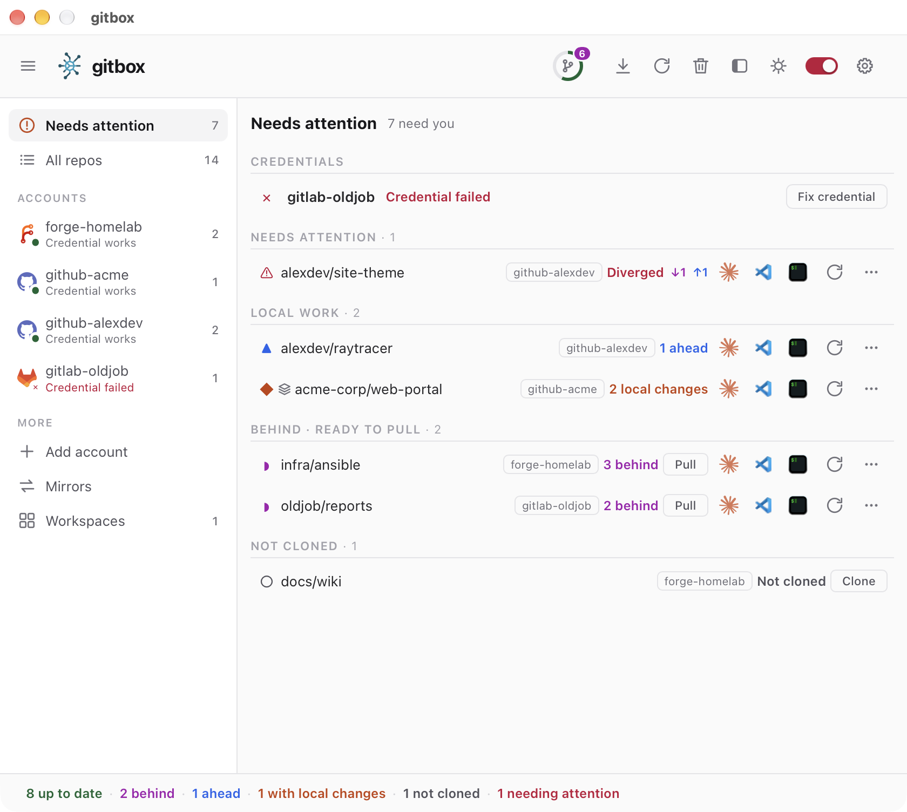
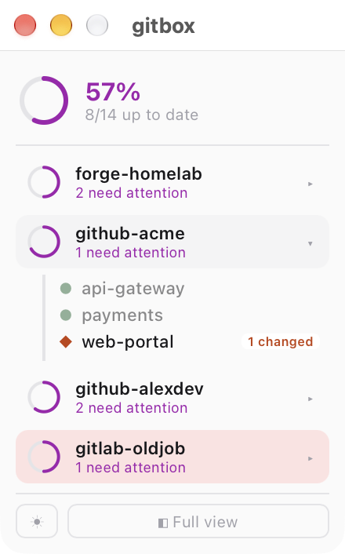
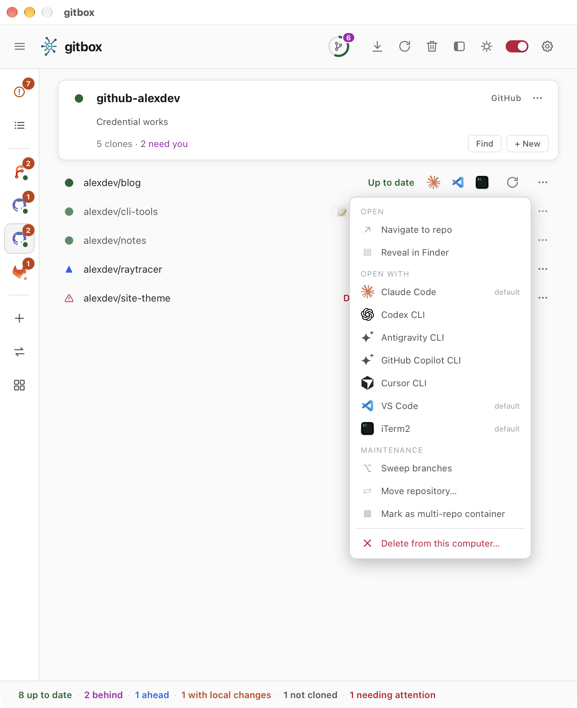

<p align="center">
  
</p>

# Gitbox desktop — guía de usuario

Gitbox es una app de escritorio que te ayuda a mantener todos tus proyectos Git organizados y actualizados, incluso cuando trabajas con varias cuentas en GitHub, GitLab, Forgejo y otros proveedores.

Esta guía recorre todo, desde el primer arranque hasta el uso diario.

## Requisitos previos

Descarga el instalador para tu plataforma desde la página de [Releases](https://github.com/LuisPalacios/gitbox/releases):

- **Windows** — `gitbox-win-amd64-setup.exe` (instala `GitboxApp.exe` en Program Files con accesos del menú Start)
- **macOS** — `gitbox-macos-arm64.dmg` o `gitbox-macos-amd64.dmg` (macOS 13 Ventura o posterior; abre el DMG, ejecuta el script de instalación desde Terminal)
- **Linux** — `gitbox-x86_64.AppImage` (autocontenido, solo descarga y ejecuta)

También puedes descargar los archivos ZIP (`gitbox-<platform>-<arch>.zip`) y extraerlos manualmente. Cada uno contiene solo la app: `GitboxApp.exe`, `GitboxApp.app` o `GitboxApp`.

> **Nota macOS:** La app no está firmada por Apple. El DMG incluye un script "Install Gitbox" que copia `GitboxApp.app` a `/Applications/` y elimina automáticamente los flags de cuarentena. Ejecuta `bash "/Volumes/gitbox/Install Gitbox.command"` desde Terminal. Para instalación manual, usa `xattr -cr /path/to/GitboxApp.app`.

Gitbox llama a herramientas que ya están en el sistema: **Git** en tu PATH y [Git Credential Manager](https://github.com/git-ecosystem/git-credential-manager) para las cuentas GCM. **Settings → System check** lista lo que falte con el comando de instalación para tu SO: consulta [Panel de ajustes](#panel-de-ajustes).

### Script de bootstrap

En macOS, Linux o Windows (Git Bash), el script de bootstrap descarga la última release e instala la app:

```bash
bash <(curl -fsSL https://raw.githubusercontent.com/LuisPalacios/gitbox/main/scripts/bootstrap.sh)
```

Usa `--version <tag>` para una release concreta o `--prefix <dir>` para cambiar el directorio de instalación (por defecto `~/bin`; macOS instala `GitboxApp.app` en `/Applications/`).

En Linux el script de bootstrap también registra la app en el menú Activities para que pueda buscar "Gitbox" o arrastrarla al dock. Omítelo con `--no-desktop`; ejecútalo más tarde por separado con `bash <(curl -fsSL https://raw.githubusercontent.com/LuisPalacios/gitbox/main/scripts/register-gitbox.sh)`. Pasa `--uninstall` al mismo script para eliminar la entrada del menú. El archivo `.desktop` apunta a una ruta absoluta, así que las actualizaciones desde la app y las ejecuciones posteriores del bootstrap no necesitan volver a registrarla.

En Windows el setup exe y el script de bootstrap son alternativas, no capas. El setup exe instala en Program Files con una entrada en el menú Inicio; el script de bootstrap instala en `~/bin` sin ninguna. Elijo uno. Cuando el script de bootstrap encuentra una copia del setup exe, avisa de que el menú Inicio sigue abriendo esa copia y la deja donde está. También detecta una instalación a medio quitar (una entrada de desinstalación cuyos archivos ya no existen) e imprime los comandos para limpiarla.

Los hosts headless no pueden ejecutar la app. Ahí, `--cli-only` instala la última CLI `gitbox` 1.x de la línea de mantenimiento v1, y el script la elige automáticamente en Linux cuando no está definida ni `DISPLAY` ni `WAYLAND_DISPLAY`.

### Linux AppImage

Descarga la AppImage, dale permiso de ejecución y ejecútala:

```bash
chmod +x gitbox-x86_64.AppImage
./gitbox-x86_64.AppImage
```

La GUI requiere un entorno de escritorio con servidor de pantalla (X11 o Wayland).

## Paso 1: primer arranque

La primera vez que abres Gitbox, una configuración guiada corta te lleva por tres pasos:

1. **Where do you keep your projects?** — elige una **root folder**, donde vivirán todos tus proyectos en disco. Algo como `~/00.git` o `C:\repos` funciona bien.
2. **Connect where your projects are stored** — elige GitHub, GitLab, Bitbucket o la tarjeta **Forgejo** y **Gitea** (después elige cuál y escribe la dirección del servidor). Escribe tu usuario, tu nombre y tu email; el nombre y el email vienen rellenos desde tu identidad global de git cuando la tiene, y aparecen en los cambios que guardes. Haz clic en **Sign in with the browser** e inicia sesión. Gitbox usa Git Credential Manager (GCM) para esto.
3. **Pick projects to download** — Gitbox lista los repositorios que tu cuenta puede ver. Marca los que quieras y haz clic en **Download**. Empiezan a clonarse en cuanto se abre la pantalla principal.

Si GCM no está instalado, el paso 2 muestra cómo instalarlo y ofrece **Use a token instead**, que enlaza a la página donde creas un token y te pide pegarlo. Si el inicio de sesión falla, puedes usar **Try again**, cambiar a un token o volver atrás con **Change details**.

Nunca escribes un account key: Gitbox elige uno por ti, como `github-alice`, que también es el nombre de la carpeta de la cuenta en disco. Puedes usar **Skip for now** en los pasos 2 y 3 y añadir cuentas más tarde. Las instalaciones nuevas empiezan en modo Simple. Si cierras la app después del primer paso, el siguiente arranque abre la pantalla principal; termina desde **Conectar una cuenta** en la barra lateral.

Cuando vuelvo a abrir Gitbox, veo los clones configurados, las preferencias guardadas y la anidación conocida de los contenedores antes de que terminen las comprobaciones de estado. Los indicadores giratorios muestran qué clones siguen pendientes de comprobación o fetch en las vistas completa, Simple y compacta. Un hijo de otro source permanece bajo su contenedor; sus acciones y su propiedad siguen correspondiendo a su propio source.

## Paso 2: añadir cuentas

Una cuenta le dice a Gitbox quién eres en un servidor concreto. Por ejemplo, tu cuenta de GitHub o el GitLab de tu empresa.

En modo Simple, **Conectar una cuenta** en la barra lateral ejecuta los mismos pasos de conectar y elegir proyectos que el primer arranque. En modo Advanced, **Añadir cuenta** abre el formulario completo, que también ofrece SSH y te deja elegir el account key. Rellenarás:

1. **Account key** — un nombre corto que eliges (por ejemplo, `github-personal`). También se convierte en el nombre de carpeta en disco.
2. **Provider** — elige tu servicio (GitHub, GitLab, Gitea, Forgejo o Bitbucket).
3. **URL** — la dirección del servidor. Para GitHub es `https://github.com`.
4. **Username** — tu nombre de cuenta en ese servicio.
5. **Name and Email** — la identidad usada en tus commits Git.
6. **Credential type** — cómo autenticará Gitbox (ver más abajo).

### Configurar credenciales

Después de crear la cuenta, Gitbox necesita una forma de iniciar sesión en tu proveedor. Hay tres opciones:

- **GCM (Git Credential Manager)** — La opción más sencilla. Gitbox abre tu navegador para que inicies sesión. Mejor para GitHub y GitLab.
- **Token (Personal Access Token)** — Creas un token en el sitio web de tu proveedor y lo pegas en Gitbox. La app te dice exactamente qué URL visitar y qué permisos seleccionar.
- **SSH** — Gitbox genera un par de claves por ti. Copias la clave pública y la añades a los ajustes de tu proveedor. La app te da el enlace directo.

Cuando las credenciales están configuradas, la entrada de la cuenta en la barra lateral y su tarjeta indican **La credencial funciona** junto a una marca verde: todo listo. Para más detalles sobre cada tipo y qué permisos seleccionar, consulta [credentials.md](credentials.md).

## Paso 3: encontrar y añadir proyectos

Selecciona la cuenta en la barra lateral y haz clic en **Buscar** en su tarjeta, o elige **Buscar proyectos…** en el menú ⋯ de la cuenta. Gitbox contacta con tu proveedor y lista todos los repositorios visibles para tu cuenta.

La ventana de discovery incluye:

- **Search field** — escribe para filtrar la lista cuando tienes muchos repos
- **Alphabetical sorting** — los repos se listan de la A a la Z para navegar fácilmente
- **Select all** — marca la casilla para seleccionar todo lo visible (respeta el filtro)
- **Already added** — los repos ya añadidos aparecen atenuados y no se pueden seleccionar de nuevo

Elige los que quieras y haz clic en **Add & Pull**. Gitbox los guarda en tu config y empieza a clonarlos en tu carpeta.

Discovery es **solo de adición**: añade repos a tu config pero nunca los elimina.

## Paso 4: día a día

Cierro cualquier diálogo con **Escape** o haciendo clic fuera de él. Los diálogos ocupados o que necesitan una decisión explícita (un clon en curso, una confirmación en marcha) siguen abiertos hasta que terminan. Los nombres de cuenta, las filas de repo y las insignias de organización también responden a **Enter** y **Espacio** cuando tienen el foco con **Tab**.

### La barra lateral

La barra lateral de la izquierda elige qué muestra el área principal:

- **Requiere atención** (Simple: **Te necesitan**) — primero las cuentas cuya credencial necesita un arreglo, cada una con su botón de arreglo, y después cada repo que me necesita, agrupados como necesita ayuda, trabajo local, por detrás y no clonado. Dentro de cada grupo, las filas quedan bajo una cabecera por cuenta, que pliego con un clic, en orden alfabético. Un contenedor anida los clones que tiene al lado, como en Todos los repos; un clon cuyo contenedor está en otro grupo muestra una etiqueta "en \<parent\>". Una fila que pasa a estar bien mientras miro, después de un pull por ejemplo, se queda en su sitio, atenuada, hasta que salgo de la vista. Cuando nada me necesita, la vista lo dice.
- **Todos los repos** (Simple: **Todos los proyectos**) — cada clon, agrupado por cuenta, en orden alfabético.
- **Cuentas** — solo cuentas: una entrada por cuenta con el logo de su proveedor, una pequeña marca de salud, su nombre, su salud en palabras y cuántos repos me necesitan. Hago clic en una para abrir la vista de la cuenta.
- **Más** — bajo el separador inferior, todo lo que no es una cuenta:
  - **Añadir cuenta** (Simple: **Conectar una cuenta**) — consulta el [Paso 2](#paso-2-añadir-cuentas).
  - **Encontrados en disco** (Simple: **Encontrados en este ordenador**) — aparece cuando hay clones en disco que todavía no están en gitbox, y abre el diálogo de adopción (consulta [Adoptar repos huérfanos](#adoptar-repos-huérfanos)).
  - **Mirrors** y **Workspaces**, solo en Advanced.

El botón de arriba a la izquierda, o ⌘B en macOS y Ctrl+B en el resto, pliega la barra lateral a un riel de iconos. El riel mantiene los logos de los proveedores con su marca de salud y su conteo de atención; al pasar el ratón sobre uno se ven el nombre de la cuenta y su salud, y un clic cambia a ella. En una ventana de menos de 780 px la barra lateral siempre se muestra como el riel, y el botón abre la barra lateral completa sobre el contenido hasta que elijo una vista.

Gitbox recuerda la última vista y la barra lateral plegada entre reinicios (`global.collapsed.view` y `global.collapsed.sidebar` en `gitbox.json`). Si esa cuenta ya no existe, o Simple no puede mostrar Mirrors o Workspaces, se abre Requiere atención en su lugar. Renombrar una cuenta conserva su vista.

### Entender la tarjeta de cuenta

La vista de una cuenta empieza con una tarjeta de tres líneas:

1. **Marca de salud y nombre** a la izquierda; hago clic en el nombre para editar la cuenta. El proveedor y el menú ⋯ de la cuenta están a la derecha.
2. **Salud en palabras**: La credencial funciona, Funciona, con un aviso, Sin conexión · no se llega al servidor, La credencial ha fallado o Sin credencial configurada (Simple: Conectado, No se puede conectar ahora, Hay que reconectar, Sin conectar). Cuando algo necesita arreglo, el botón de la derecha lo hace: **Reintentar** vuelve a comprobar una cuenta sin conexión, y **Arreglar credencial**, **Configurar credencial** o **Reconectar** de Simple abren la pantalla de credenciales. En Advanced, al pasar el ratón sobre las palabras se ven el tipo de credencial y sus mensajes.
3. **Conteos**: cuántos repos tiene la cuenta y cuántos me necesitan. **Buscar** descubre repos y **+ Crear** crea uno, en los dos modos. Ambos se deshabilitan, con el motivo al pasar el ratón, cuando la credencial no llega a la API del proveedor.

Cuando a un token de GitHub o GitLab que funciona le quedan 14 días o menos para caducar, la salud en palabras pasa a **El token caduca en N días** en naranja, y **Cambiar token** (Simple: **Renovar**) abre la pantalla de credenciales. La entrada de la barra lateral y su tooltip dicen lo mismo. En Avanzado, al pasar el ratón por las palabras también se ve la fecha de caducidad de cualquier token que la tenga. Los tokens sin caducidad, y las cuentas de Gitea, Forgejo y Bitbucket, cuyas APIs no la informan, se ven como antes.

Una credencial ausente o rota tiñe la tarjeta de **rojo claro**, y un aviso la tiñe de naranja. Los clones de la cuenta siguen a la tarjeta, en orden alfabético. Un clon anidado en el contenedor de otra cuenta aparece aquí con una etiqueta "en \<parent\>"; **Todos los repos** lo mantiene bajo su contenedor.

### Mantener proyectos sincronizados

#### Comprobación automática

Gitbox vigila tus proyectos y muestra su estado:

- **Al día** (verde) — coincide con el remoto
- **N por detrás** (magenta) — el remoto tiene N commits nuevos que puedes traer
- **N cambios locales · protegidos** (naranja) — tienes trabajo sin commitear, y nada en Gitbox lo toca
- **N por delante** (azul) — tienes N commits que no has pusheado
- **Divergido**, **Conflicto**, **Upstream eliminado** y **Error** (rojo) — el repo necesita una revisión; haz clic en él para ver los detalles
- **No clonado** (gris) — el repo todavía no está en este ordenador; **Clonar** lo descarga
- **Rama local** (verde) — en una feature branch sin upstream tracking (normal)
- **No upstream** (gris) — la rama predeterminada no tiene upstream tracking (requiere atención)

Los clones aparecen siempre en orden alfabético del nombre que muestra la fila, también los anidados. Cuando alguna fila de una lista me necesita, las filas sin nada que hacer se atenúan ligeramente hasta que paso el ratón por encima, para que los problemas destaquen; cuando nada me necesita, ninguna fila se atenúa.

Cuando un repo está checked out en una rama no predeterminada, aparece una pequeña insignia de rama junto al nombre del repo (por ejemplo, `feature-xyz`). Los repos en la rama predeterminada no muestran insignia. El estado detached HEAD muestra una insignia roja `detached`.

#### Pull de todo

Haz clic en el botón **Pull de todo** (icono de flecha hacia abajo) en la barra superior para actualizar todo con un clic. Clona repos ausentes y hace pull de repos que están por detrás solo con avance rápido (`git pull --ff-only`), así que nunca fusiona y nunca toca los cambios locales. El botón **Pull · solo FF** propio de una fila por detrás hace lo mismo para un repo. En Simple, el botón es **Actualizar todo**.

#### Fetch de todo

Haz clic en el botón **Fetch de todo** (icono ↻) para consultar todos los remotos por commits nuevos sin hacer pull. Esto actualiza los indicadores de estado para que veas qué cambió antes de decidir si quieres hacer pull. En Simple, el botón es **Comprobar todo**.

#### Tarjetas de actividad y de resultado

Mientras se ejecuta Fetch de todo o Pull de todo, una tira bajo la barra superior dice qué abarca, como "Haciendo fetch de 17 clones en 3 cuentas" o "Haciendo pull de 2 (solo avance rápido) y clonando 1", con una barra de progreso. Cuando termina, una tarjeta de resultado en la esquina inferior derecha lo resume: cuántos clones recibieron fetch, cuántos están ahora por detrás y listos para pull, cuáles omitió porque su cuenta está sin conexión, cualquier fallo con el primer error, y que los cambios locales quedaron intactos. Las tarjetas de éxito desaparecen tras unos segundos; una tarjeta con un fallo se queda hasta que la cierro. Los fetch del arranque y los periódicos solo dejan tarjeta cuando algo cambió o falló.

Otras acciones informan de sus errores de la misma forma, por ejemplo una herramienta que no se abre o un mirror que no se puede añadir.

#### Fetch periódico

En Settings puedes activar fetch automático cada 5, 15 o 30 minutos. Gitbox comprueba todos los remotos y re-verifica salud de credenciales en segundo plano.

Cuando coinciden el arranque, las comprobaciones periódicas y el refresco manual, veo un único ciclo de refresco compartido. El estado local aparece en cuanto terminan las comprobaciones Git; el indicador de fetch permanece activo hasta que terminan las comprobaciones de credenciales y proveedores de ese ciclo. Un proveedor lento o inaccesible no convierte un clone conocido en un upstream ausente. Si el mantenimiento del repositorio no puede restaurar la identidad, origin o aislamiento de credenciales configurados, veo su aviso y el fetch de ese clone se detiene.

#### Ver detalles

Haz clic en un repo que muestre cambios locales, conflictos u otros problemas. Aparece un panel expansible que muestra:

- La rama actual y cuántos commits estás ahead o behind
- Una lista de cada archivo modificado con iconos que muestran qué ocurrió (added, deleted, renamed, modified)
- Cualquier archivo untracked

Esta vista de detalle **se actualiza automáticamente** cuando Gitbox detecta cambios nuevos: no necesitas cerrarla y volver a abrirla.

### Adoptar repos huérfanos

El modal de orphans lista clones bajo tu carpeta padre que todavía no están en `gitbox.json`, agrupados por cómo Gitbox puede gestionarlos:

- **Ready to adopt** — Gitbox emparejó el clon con una cuenta usando su URL remota, el `credential.<url>.username` del repo o la carpeta donde vive. Marca la casilla y haz clic en **Adopt** para registrarlo (y opcionalmente reubicarlo a la ruta canónica).
- **Unknown account** — ninguna cuenta configurada coincide con el host remoto. Añade una cuenta primero y vuelve a abrir el modal.
- **Unknown account, `ambiguous: a | b`** — dos o más cuentas en el mismo host empatan en cada señal de identidad que Gitbox mira. La casilla está deshabilitada para que no se muevan archivos. Para desambiguar: mueve el clon bajo el subtree de source correcto, edita `gitbox.json` para reflejar la cuenta deseada, o establece `credential.<url>.username` en el clon; luego vuelve a abrir el modal.
- **Local only** — sin remoto `origin`, no adoptable.

Para cada clon adoptado, Gitbox lo añade a `gitbox.json` bajo la source emparejada, configura el aislamiento de credenciales por repo, fija `user.name` y `user.email` a partir de la cuenta y reescribe la URL remota para que coincida con el tipo de credencial. Las reglas de puntuación detrás del emparejamiento de cuenta están en [Arquitectura › pkg/adopt](architecture.md#pkgadopt--discovery-de-repos-huérfanos).

### Crear repositorios

Haz clic en **+ Crear** en la tarjeta de cuenta, o elige **Crear repo…** en el menú ⋯ de la cuenta, para crear un repositorio nuevo directamente en el proveedor sin salir de Gitbox.

El modal pide:

- **Owner** — un dropdown que lista tu usuario personal y cualquier organización a la que pertenezcas. La API del proveedor determina qué organizaciones están disponibles.
- **Name** — el nombre del repositorio. Los caracteres inválidos se eliminan automáticamente (solo se permite `a-z`, `A-Z`, `0-9`, `.`, `_`, `-`). Los espacios se convierten en guiones mientras escribes.
- **Description** — un resumen opcional de una línea.
- **Private** — marcado por defecto. Desmarca para crear un repo público.
- **Clone after creating** — marcado por defecto. Cuando está activo, Gitbox añade el repo a tu config y lo clona inmediatamente.

El texto del botón cambia según la casilla de clone: **Create & Clone** o **Create**.

La creación de repos está soportada en todos los proveedores (GitHub, GitLab, Gitea, Forgejo y Bitbucket) y funciona con todos los tipos de credencial. Se usa para creación el mismo token API que para discovery.

### Editar una cuenta

Haz clic en el nombre de la cuenta en su tarjeta, o elige **Editar cuenta…** en el menú ⋯ de la cuenta, para abrir la pantalla de edición. Puedes cambiar:

- **Account key** — si lo renombras, Gitbox se encarga de todo: renombra la carpeta en disco, actualiza tus claves SSH y config, migra tokens guardados y corrige todas las referencias internas.
- **Provider** — por si elegiste el equivocado originalmente.
- **All other fields** — URL, username, name, email, default branch.

### Gestionar credenciales

Elige **Cambiar credencial…** en el menú ⋯ de la cuenta para abrir la pantalla de gestión de credenciales. Cuando la credencial necesita un arreglo, el botón de la tarjeta de cuenta y el de Requiere atención abren la misma pantalla; en Simple, el menú ofrece **Reconectar…** en su lugar, y solo cuando la credencial está rota. Para detalles de cada tipo y permisos necesarios, consulta [credentials.md](credentials.md).

#### Cambiar tipo de credencial

Usa el dropdown para cambiar entre GCM, Token y SSH. Haz clic en **Setup** para aplicar el cambio. gitbox elimina la credencial antigua y sus artefactos, configura la nueva y reconfigura automáticamente todos los clones existentes.

#### Eliminar una credencial

Cuando ves el tipo de credencial actual, haz clic en el botón rojo **Delete** para eliminar todos los datos de autenticación guardados. Esto es útil cuando necesitas empezar limpio: por ejemplo, si un token caducó o quieres comenzar de nuevo.

Después de eliminar, la tarjeta se vuelve roja e indica **Sin credencial configurada**. Haz clic en **Configurar credencial** para empezar de nuevo.

## Paso 5: mirrors (opcional)

Los mirrors mantienen copias de backup de repos en otro proveedor: por ejemplo, push desde un Forgejo de homelab a GitHub. Los repos se mirrorizan server-side mediante APIs de proveedor, no se clonan localmente.

### La vista Mirrors

En Advanced, **Mirrors** bajo **Más** en la barra lateral abre la vista Mirrors: una cabecera con los botones **Descubrir** y **Comprobar todo**, las tarjetas de grupos mirror y debajo la lista de detalle de mirrors. Cada grupo mirror aparece como un chip que se abre en una tarjeta con su proporción active/total. El **summary footer** de abajo siempre muestra conteos de repos y mirrors, sea cual sea la vista.

### Tarjetas de mirror

Cada grupo mirror se muestra como un chip (status dot y par de cuentas) que se abre en una tarjeta; al hacer clic fuera de ella o pulsar **Escape** vuelve a plegarse. La tarjeta muestra:

- **Status dot** — verde si todos los repos están activos, rojo si hay errores, ámbar en caso contrario
- Etiqueta **MIRROR** y los mirrors `active/total` del grupo, con el color del punto
- **Par de cuentas** (por ejemplo, `forgejo ↔ github`)
- Botón **Check** — verifica estado de sync comparando commits HEAD en ambos lados
- Un chip **+** después de las tarjetas crea un grupo mirror nuevo

### Anillo de salud de mirror

La barra superior muestra anillos compactos sin etiquetas en los dos modos. El anillo de repos lleva un icono de rama y se llena a medida que los clones se ponen al día; en Simple, se llena a medida que los proyectos se guardan. En Advanced, cuando hay mirrors configurados, un segundo **health ring** con un icono de dos flechas se llena a medida que los mirrors pasan a activos y se vuelve rojo si algún mirror tiene errores. Una pequeña insignia en cada anillo cuenta lo que aún falta, y al pasar el ratón sobre un anillo se ve la línea completa `N de total al día` (Simple: `N de total guardados`) o `active/total`. Cuando un anillo tiene algo pendiente, al hacer clic se abre **Requiere atención** (Simple: **Te necesitan**); el anillo de mirrors abre **Mirrors**.

### Acciones de mirror

La cabecera de la vista Mirrors ofrece dos botones:

- **Descubrir** — escanea todos los pares de cuentas para detectar relaciones de mirror existentes, con confianza decreciente: API de push mirror (confirmed), flag de pull mirror (likely) y coincidencia de nombre (possible). Durante el escaneo, una barra de progreso muestra avance por cuenta (indeterminado durante el listado de repos, determinado durante el análisis). Cuando aparecen resultados, los repos ya presentes en tu config se marcan como **"configured"** y aparecen atenuados. Cada resultado no configurado tiene un botón individual **+ Add** para añadirlo a tu config uno a uno, o puedes usar **Apply to config** para añadir todos a la vez.
- **Comprobar todo** — comprueba el estado de sync de cada grupo mirror.

### Lista de detalle de mirror

Bajo las tarjetas de mirror, cada grupo se expande en una lista de detalle con repos mirrorizados individuales:

- Etiqueta de dirección (por ejemplo, `origin → backup (mirror)`)
- Estado de sync (Synced OK, Backup is behind origin, etc.)
- Icono de aviso si el repo de backup es público
- Botón **Setup** para repos que todavía no se han configurado mediante API
- Botón **+ Repo** para añadir repos nuevos al grupo

## Paso 6: workspaces (solo lectura)

La vista **Workspaces**, bajo **Más** en la barra lateral en Advanced, lista los archivos `.code-workspace` de VS Code descubiertos. Los workspaces son de solo lectura: la GUI descubre los archivos existentes, los lista con sus clones miembro resueltos y abre uno en mi editor. Nunca los crea, edita, genera ni borra: los archivos son míos. Cada entrada tiene un botón **Abrir** que abre el `.code-workspace` en el primer editor de `global.editors`; el botón **Descubrir** de la vista reescanea bajo demanda.

### Auto-descubrimiento al arrancar

Cuando dejo un archivo `*.code-workspace` bajo la carpeta gestionada por gitbox (o una carpeta extra configurada), o traigo uno desde otra máquina, la GUI lo recoge: la lista en caché aparece al instante al arrancar y luego una pasada en segundo plano la refresca, actualizando la vista si algo cambió. Discovery recorre `global.folder` y cada raíz de `global.extra_folders` en busca de archivos `*.code-workspace`. Las carpetas de cada archivo se resuelven de vuelta a clones conocidos por coincidencia deepest-prefix, y la caché de `gitbox.json` solo se reescribe cuando algo cambió.

### Clones no estándar y contenedores multi-repo

Un **contenedor multi-repo** es un clon gestionado que mantiene otros clones anidados en su árbol de trabajo (por ejemplo, un repo de proyecto cuyo `.code-workspace` agrupa varios clones hermanos). Cuando un clon parece serlo — tiene un `.code-workspace` en su raíz pero aún no está marcado — su fila muestra un aviso inline **onboard nested clones**. Al hacer clic, marca el clon como contenedor, escanea su árbol de trabajo y abre el modal de adopción con los clones anidados que encuentra; tú confirmas cuáles incorporar. Los clones anidados se adoptan en el lugar bajo su cuenta/org real (se guardan con una `clone_folder` absoluta dentro del contenedor, nunca se reubican), y el aviso se reemplaza por un icono 📁; al pasar el ratón indica que es un contenedor.

También puedes gestionarlo desde el menú ⋯ de la fila del repo, bajo **Mantenimiento** — **Mark as multi-repo container**, **Unmark as multi-repo container** y **Re-scan for nested clones** (visible una vez que el clon es contenedor) — o con la casilla **Multi-repo container** del panel de detalle del repo. El diálogo **Change root folder** gestiona las **carpetas de escaneo extra** (raíces adicionales escaneadas en busca de clones y archivos `.code-workspace`) y la **profundidad de escaneo anidado** (cuántos niveles desciende Gitbox por debajo de un contenedor, por defecto 1: los hijos inmediatos del contenedor; súbela para alcanzar clones anidados más profundos).

El layout estándar es `global.folder / <account> / <org|user> / repo`. Los clones encontrados en una carpeta de escaneo extra aparecen en el modal de orphans y se incorporan **en el lugar** con una `clone_folder` absoluta: Gitbox nunca los mueve.

## Vistas del dashboard

### Modos Simple y Advanced

Gitbox tiene dos experiencias. **Simple** es para quien no conoce git y solo quiere sus proyectos a salvo. **Advanced** muestra cada detalle y herramienta de git. Cambio de modo con el interruptor de la barra superior, a la izquierda del engranaje de ajustes: gris es Simple, rojo es Advanced, el modo con poder destructivo. Las instalaciones nuevas empiezan en Simple; las configs anteriores a este ajuste se quedan en Advanced. La elección se guarda como `global.ui_mode` en `gitbox.json`.

En Simple, cada proyecto responde a una pregunta, "¿está a salvo mi trabajo?", con uno de seis estados:

- **Guardado** — todo está en el servidor.
- **Trabajo en curso · N archivos a salvo aquí** — archivos cambiados en este ordenador que todavía no están en el servidor. Abro el proyecto con mi IA y le pido que los guarde.
- **Guardado aquí, sin subir** — cambios guardados que no han llegado al servidor (pasa el ratón para ver el detalle).
- **Versión nueva en línea** — el servidor tiene trabajo más nuevo. Botón: **Actualizar**, que solo añade la versión nueva y nunca toca mi trabajo. Gitbox nunca actualiza por su cuenta.
- **Solo en línea** — el proyecto aún no está en este ordenador. Botón: **Descargar**.
- **Necesita ayuda** — algo ha ido mal, por ejemplo cambiaron las dos copias. Hago clic en el proyecto para ver qué pasa y lo abro con mi IA para arreglarlo.

Cada proyecto que está en este ordenador tiene tres botones de icono, tanto en Simple como en Advanced: mi primer AI harness, mi primer editor y mi perfil de terminal por defecto. Cada uno muestra el logo de la herramienta cuando gitbox lo conoce (Claude, Codex, Gemini, Cursor, VS Code, Zed y cada app de terminal que gitbox detecta) o un icono genérico, y su nombre al pasar el ratón. Los nombres se muestran sin el prefijo de la organización; al pasar el ratón sobre un nombre se ve completo. El menú ⋯ mantiene Open on the web, la carpeta, los editores, los AI harnesses y **Delete from this computer…**.

Simple oculta el resto: las vistas Mirrors y Workspaces, delete mode, los botones de vista compacta y de tema (el tema sigue en Settings), los badges de workspace, contenedor y rama, los conteos ahead, behind y de cambios, y el botón de fetch de cada fila. Los PR abiertos que he creado (📝) y los PR que esperan mi revisión (👀) aparecen en los dos modos. La barra superior mantiene **Comprobar todo** y **Actualizar todo**. La salud de la cuenta se lee en palabras sencillas, y **Reconectar** aparece cuando una credencial se rompe. Settings oculta las filas del archivo de config, PR reviews, global gitignore y Terminals. La vista compacta es igual en los dos modos.

### Vista completa

El dashboard completo muestra la barra superior con health rings, la barra lateral, la vista seleccionada y el summary footer. Los botones de acción en la barra superior incluyen Pull de todo, Fetch de todo, Delete mode, Compact view, el tema, el interruptor Simple/Advanced y Settings; el botón del extremo izquierdo pliega la barra lateral. La ventana se abre con 1040 px de ancho la primera vez y puede encogerse hasta 640 × 480; no crece más allá de la barra lateral más 1100 px de contenido, y al plegar la barra lateral su ancho pasa al contenido.

### Contraer y expandir

La vista **Todos los repos** se pliega a dos niveles, y la vista de una cuenta también pliega los clones padre:

- **Grupos de cuenta** — hago clic en la barra de cabecera de una cuenta o en su nombre para plegar su lista de clones. La cabecera siempre muestra cuántos clones contiene y cuántos requieren atención, plegada o no, así que un problema nunca queda oculto tras un pliegue. El menú ⋯ de la cabecera sigue funcionando y nunca pliega el grupo.
- **Clones con clones debajo** — cualquier clon que tenga clones anidados bajo él muestra un chevron ▾ antes de su punto de estado. Al pulsar el chevron o el nombre del clon se pliega todo lo que hay debajo, a cualquier profundidad. Una fila plegada muestra cuántos clones oculta y cuántos de ellos requieren atención. Ninguno de los dos abre el detalle del repo.

Gitbox recuerda lo que pliego entre reinicios, junto con la barra lateral y la última vista (`global.collapsed` en `gitbox.json`), y olvida las entradas de cuentas o clones que borro o renombro. La vista compacta mantiene su propia expansión por cuenta.

### Vista compacta

Haz clic en el botón **◧** en la barra superior para cambiar a modo compacto: una tira estrecha de estado (~220px de ancho) que muestra:

- **Global health ring** — porcentaje y conteo global de sync
- **Account pills** — una por cuenta con un mini ring y conteo de problemas. Haz clic para expandir y ver repos individuales debajo
- **Mirror pill** — cuando hay mirrors configurados, muestra el conteo active/total con un punto de color
- **Theme toggle** y un botón **Full view** abajo

Esto es útil cuando quieres tener gitbox visible como sidebar mientras trabajas en otras apps. Haz clic en **◧ Full view** para volver al dashboard completo.

<p align="center">
  
</p>

## Ajustes y mantenimiento

### Panel de ajustes

Haz clic en el **icono de engranaje** para abrir el panel de ajustes:

- **Config** — muestra la ruta a tu archivo de config con un botón "Open in Editor"
- **Root folder** — dónde se guardan los proyectos, con un botón "Change"
- **Theme** — cambia entre System, Light y Dark
- **Fetch periódico** — intervalo de fetch automático (off, 5m, 15m, 30m)
- **Run at startup** — lanzar Gitbox automáticamente al iniciar sesión (dependiente de plataforma)
- **System check** — **Run** abre un informe de cada herramienta externa que usa gitbox (`git`, `git-credential-manager`, `ssh`, `ssh-keygen`, `ssh-add` y `wsl` en Windows), dónde está instalada, su versión y, para cualquier cosa ausente que tu config necesite, un comando de instalación. Cada herramienta se marca como ok, missing (requerida por tu config) u optional.
- **Terminals** — **Manager** abre el editor de Perfiles de terminal en su propia ventana del SO. Tres secciones: aplicaciones de terminal detectadas (solo lectura), shells detectados (solo lectura) y Perfiles (las parejas Terminal × Shell que el menú ⋯ puede lanzar). Cada fila de terminal y de perfil empieza con el logo de la app de terminal. Alterna Default / Preferred / Hidden por fila, edita el nombre + Terminal + Shell de un Perfil, añade Perfiles definidos por el usuario o elimina los que tú añadiste. Re-detect vuelve a sondear el host para captar nuevos shells, entradas frescas de `launch_menu` de WezTerm o terminales recién instaladas sin reiniciar la GUI. La ventana es propiedad de la app principal — al cerrar la ventana principal también se cierra el Manager.

  Cuando hago clic en un Perfil `WezTerm + <Shell>` o `Windows Terminal + <Shell>`, gitbox primero busca una entrada coincidente en mi propia configuración del terminal (`launch_menu` de `wezterm.lua` para WezTerm, `profiles.list` de `settings.json` para Windows Terminal). Si encuentra una, gitbox la lanza — para WezTerm construye `wezterm-gui.exe start --cwd <path> -- <argv de la entrada>` y empalma el `set_environment_variables` de la entrada sobre el entorno padre; para Windows Terminal ejecuta `wt.exe -w 0 nt --profile "<name>" -d <path>` para que WT aplique el font, los colors y el `commandline` de mi perfil sin spawnear una segunda ventana cuando está activo `firstWindowPreference: persistedWindowLayout`. Sin coincidencia (o sin config / terminal no instalado), gitbox cae en su plantilla genérica de argv. Nota: la lógica de picker-callback de WezTerm en `wezterm.lua` (`color_scheme` por entrada, hooks personalizados de `mux.spawn_window`, etc.) solo se dispara cuando la entrada se elige desde el propio launcher menu de WezTerm — gitbox spawneando el pane externamente salta esos callbacks. Ver [Arquitectura › Cómo funciona el emparejamiento de lanzamiento](architecture.md#cómo-funciona-el-emparejamiento-de-lanzamiento) para las reglas del comparador (sufijo tras em-dash, patrón de respaldo para `pwsh` / `cmd` / distros WSL, etc.).

- **Versión** — versión actual de la app
- **Author** — autor del proyecto y enlace al repositorio de GitHub

Los flujos add-account y change-credential ejecutan la misma comprobación automáticamente: si eliges el tipo de credencial `gcm` en una máquina sin Git Credential Manager instalado, recibes un banner amarillo con el comando de instalación en lugar de un fallo críptico de autenticación más tarde.

### Acciones de clones

Cada fila de repo clonado tiene un **menú ⋯** en el lado derecho. Es una lista plana por secciones, sin submenús:

1. **Abrir** — **Navigate to repo** y **Reveal in Finder** (Explorer, o el gestor de archivos en Linux). La entrada de navegador abre `<account url>/<owner>/<name>`, resuelto en el lado Go a partir de la config guardada, y muestra una tarjeta de error si la fila no se encuentra ahí. Toda entrada basada en ruta (carpeta, editor, terminal, AI harness) muestra un mensaje de "clona primero" en lugar de no hacer nada cuando el clon no ha terminado o su estado todavía no se ha cargado.
2. **Abrir con** — cada AI harness y editor, y después el Terminal Profile por defecto y los marcados como Preferred, cada uno con su logo. La herramienta que usa el botón de lanzamiento propio de la fila lleva una etiqueta **predeterminado**.
3. **Mantenimiento** (Advanced) — **Sweep branches**, **Move repository…**, **Mark as multi-repo container** o **Unmark as multi-repo container**, y **Re-scan for nested clones**.
4. **Borrar de este ordenador…** — en los dos modos.

<p align="center">
  
</p>

Junto al menú ⋯, cada fila clonada tiene tres botones de lanzamiento: el primer AI harness, el primer editor y el Terminal Profile por defecto (Simple también muestra el AI harness y el editor). En Mantenimiento:

- **🧹 Sweep branches** — encuentra y elimina ramas locales obsoletas. Muestra un diálogo de confirmación con la lista de ramas antes de eliminar nada. La rama actual y la rama predeterminada nunca se tocan. Detecta tres tipos de rama obsoleta:
  - **Gone** — la rama de remote tracking se eliminó (por ejemplo, se mergeó una PR y su rama se borró en el servidor); se elimina con `git branch -D`.
  - **Merged** — totalmente mergeada en la rama predeterminada; se elimina con `git branch -d`.
  - **Squashed** — squash-merged o rebase-merged en el servidor (commits distintos, mismos cambios); se elimina con `git branch -D`.

Para cambiar qué editor o AI harness usa el botón de lanzamiento de la fila (la etiqueta **predeterminado**), reordena el array en `gitbox.json`: la primera entrada siempre es el default. El default de terminal es el profile marcado como Default en **Settings → Terminals → Manager**.

La detección de terminales cubre Windows Terminal, WezTerm, Alacritty, Tabby, ConEmu, Hyper, Mintty y ZOC en Windows; iTerm2, Terminal, Warp, Kitty, Ghostty, WezTerm y Alacritty en macOS; GNOME Terminal, Konsole, Terminator, Foot, Alacritty, Kitty, Tilda, Guake y xterm en Linux. La detección de shells cubre PowerShell 7/5, Command Prompt, Git Bash y WSL en Windows; Zsh, Bash, Fish y Dash en macOS; Bash, Zsh, Fish, Ksh y Dash en Linux. Los editores cubren VS Code, Cursor, Zed y cualquier otro detectable en `PATH`. Los AI harnesses (Claude Code, Codex, Antigravity, Aider, Cursor Agent, OpenCode) se ejecutan dentro del shell del Terminal Profile por defecto: consulta [AI harness actions](#acciones-de-ai-harness) más abajo.

### Acciones de cuenta

Cada cuenta tiene un **menú ⋯**: en su tarjeta en la vista de la cuenta, y en la cabecera de su grupo en **Todos los repos**. Usa las mismas secciones planas que el menú de repo, pero aplicado a la carpeta padre de la cuenta (`<global.folder>/<account-key>`) en lugar de a un clon concreto:

- **Navigate to account** — abre la página de perfil/org del proveedor para la cuenta (por ejemplo, `https://github.com/<username>`, la página de grupo de GitLab, la página de usuario de Gitea/Forgejo).
- **Reveal in Finder** (Explorer, o el gestor de archivos) — abre la carpeta padre de la cuenta en el gestor de archivos del SO. La carpeta es la raíz natural de workspace para greps multi-repo, ediciones multi-repo o loops de shell. Si la carpeta todavía no existe (nada clonado bajo esa cuenta), la acción falla silenciosamente: clona al menos un repo primero.
- **Abrir con** — las mismas entradas de terminal, editor y AI harness que el menú de repo. Sweep branches no aparece aquí: solo tiene sentido en un clon concreto.
- **Cuenta** — **Buscar proyectos…** y **Crear repo…**, deshabilitadas cuando la credencial de la cuenta no llega a la API del proveedor; **Editar cuenta…**; y **Cambiar credencial…** en Advanced, o **Reconectar…** en Simple cuando la credencial está rota.

Los editores se auto-detectan al arrancar escaneando PATH. Gitbox escribe los editores detectados en `global.editors` en tu archivo de config con sus rutas completas. Puedes reordenar entradas o añadir editores custom editando la config: el menú siempre refleja el orden de la config.

Las terminales usan profiles en su lugar. Al arrancar, gitbox detecta las apps de terminal y los shells instalados, los escribe en `global.terminal_apps` y `global.shells`, y los combina en entradas lanzables en `global.terminal_profiles`. En Windows un profile empareja una terminal con un shell, por ejemplo Windows Terminal + PowerShell 7. En macOS y Linux un profile es solo la terminal y ejecuta tu login shell. Los gestiono en **Settings → Terminals → Manager**: marco un profile como Default (el botón de terminal de la fila y la etiqueta **predeterminado** del menú), marco otros como Preferred (listados bajo **Abrir con**), oculto los que nunca uso o añado los míos. La re-detección conserva mis flags, renombrados, args editados a mano y los profiles que añadí.

En Windows, los profiles de shell desnudo que abren un shell sin app de terminal (`pwsh.exe`, `powershell.exe`, `cmd.exe`, `wsl.exe`) están ocultos por defecto, y solo aparecen por sí mismos cuando no hay ninguna terminal moderna instalada. Muestra uno en el Manager para tener un acceso directo. El launcher los envuelve en `cmd.exe /C start "" /D <path>`, lo que da a cada shell una consola nueva y fija el directorio inicial.

#### Perfiles de Windows Terminal y WezTerm

Cuando un profile usa Windows Terminal, gitbox busca un perfil WT que coincida en `settings.json` en el momento del lanzamiento. `Windows Terminal + PowerShell 7` coincide con el perfil WT llamado `PowerShell 7`, y un shell WSL por distro coincide con el perfil WT de esa distro. Si hay coincidencia, gitbox ejecuta `wt.exe -w 0 nt --profile "<name>" -d <path>`, así que el shell se abre como pestaña nueva en tu ventana WT más reciente con la fuente, los colores y los ajustes de arranque que configuraste en WT. Los perfiles ocultos y los perfiles cuyo `source` aparece en el `disabledProfileSources` de nivel superior de WT nunca coinciden. Sin coincidencia, gitbox usa los argumentos genéricos de Windows Terminal.

Ubicaciones comprobadas, en orden: `%LOCALAPPDATA%\Packages\Microsoft.WindowsTerminal_8wekyb3d8bbwe\LocalState\settings.json` (Store), `…\Microsoft.WindowsTerminalPreview_8wekyb3d8bbwe\…` (Preview), `%LOCALAPPDATA%\Microsoft\Windows Terminal\settings.json` (sin empaquetar). Gitbox vuelve a leer el archivo cada vez que cambia, así que renombrar o añadir un perfil WT se aplica en el siguiente lanzamiento.

WezTerm funciona en todos los OS: cuando `wezterm.lua` define un `config.launch_menu`, cada sync añade un profile por entrada, y al lanzarlo se ejecutan los `args` propios de esa entrada.

Para renombrar un profile o cambiar su terminal o shell, edítalo en el Manager. Para pasar flags extra, edita sus `args` en `gitbox.json`: la re-detección conserva los args editados a mano.

#### Lanzar gitbox desde Git Bash (nota de desarrollo)

Si lanzas `GitboxApp.exe` desde una shell Git Bash / MSYS2, las variables de entorno Windows heredadas por la GUI llegan en forma posix (por ejemplo, `LOCALAPPDATA=/c/Users/you/AppData/Local`). Esos valores se propagan a terminales abiertas desde gitbox mediante la ruta default `cmd.exe /C start …`, y herramientas que las leen como rutas Windows — `oh-my-posh`, algunos helpers de `$PROFILE` — pueden atragantarse (`& '/c/Users/...' — not recognized as a cmdlet`). Gitbox sanea el bloque env que entrega a la terminal lanzada, pero cuando Windows Terminal es el host de consola predeterminado, la ruta de delegación de WT puede saltarse ese bloque.

Dos arreglos igual de limpios:

- **Lanza `GitboxApp.exe` desde Explorer, el menú Start o un acceso anclado**: cualquier lugar donde Windows origine un env limpio. Los usuarios finales nunca ven esto, así que el comportamiento de producción no se afecta.
- **Usa un perfil de Windows Terminal** que coincida con el shell, como se describe arriba. Gitbox lanza entonces mediante `wt.exe --profile`, y WT inicia el shell desde su propio contexto de perfil, que tiene env Windows limpio independientemente de cómo se haya lanzado la GUI.

El **modo compacto** solo muestra el estado. Cambia a vista completa para acceder a las acciones de clone y de cuenta.

### Acciones de AI harness

Los AI CLI harnesses (Claude Code, Codex, Antigravity, Aider, Cursor Agent, OpenCode, …) son procesos shell interactivos: necesitan una terminal para ejecutarse. Gitbox añade una entrada por harness configurado bajo **Abrir con** tanto en el menú ⋯ de repo como en el menú ⋯ de cuenta. Hacer clic abre el **Terminal Profile por defecto** en la carpeta objetivo y ejecuta el harness dentro del shell de ese profile, así la misma terminal y shell que obtienes con `>_ <profile>` aloja el harness.

Elijo el host escogiendo el profile por defecto en **Settings → Terminals → Manager** (el mismo default que usa el launcher). Para cambiar de host, marca otro profile como default.

El harness se ejecuta a través del shell del profile en lugar de como comando desnudo de la terminal. Así los ficheros rc de tu shell siguen aplicando (el PATH de `nvm`/`npm` en macOS y Linux, el PATH de Git Bash en Windows), que es donde viven la mayoría de los CLIs de harness, y te deja en un prompt interactivo cuando el harness termina. PowerShell recibe `-NoExit -EncodedCommand`, `cmd` recibe `/K`, `fish` recibe `-C`, cualquier otro shell POSIX recibe `-i -c '<harness>; exec <shell>'`. En Windows, Git Bash recibe los shims `.cmd` de npm por nombre desnudo (`claude`, resuelto en su propio PATH) y los binarios nativos por su ruta con barras normales; WSL siempre recibe el nombre desnudo. Los profiles sin shell explícito (macOS, Linux) usan `$SHELL`.

Los perfiles de Windows Terminal emparejados desde `settings.json` reciben el shell envuelto como commandline final de WT, así la fuente y los colores del perfil WT siguen aplicando. Las entradas `launch_menu` de WezTerm se envuelven igual usando el shell de los propios `args` de la entrada. Terminal.app e iTerm en macOS no aceptan un comando en su línea de lanzamiento `open -a`, así que gitbox los controla mediante AppleScript (`cd <carpeta> && <harness>`); la primera ejecución puede pedir permiso de Automation. Warp, Kitty, Ghostty y Alacritty en macOS no pueden alojar un comando: con uno de ellos como profile por defecto, hacer clic en una entrada AI harness muestra un error accionable con el nombre del profile; marca iTerm, Terminal o WezTerm como default en su lugar.

Los harnesses se detectan en segundo plano, no en la ruta de arranque: una primera pasada corre unos dos segundos después de abrirse la ventana, luego cada diez minutos, y de nuevo cada vez que la ventana recupera el foco (limitado a una vez por minuto). El menú se refresca solo cuando la lista cambia: sin reiniciar, sin recargar config. El sondeo nunca toca el PATH del proceso, así que es seguro mientras hay fetches y clones en marcha. Además de PATH, gitbox sondea `~/.local/bin` en todos los sistemas (los instaladores nativos de Claude Code, Antigravity, Codex, Goose y los gestionados por uv dejan ahí sus binarios, y una GUI lanzada desde el Dock, un menú de escritorio o el menú Inicio no hereda el PATH del shell), los prefijos de Homebrew en macOS, y cualquier directorio conocido específico de la herramienta que liste el catálogo (por ejemplo `%LOCALAPPDATA%\agy\bin` para Antigravity en Windows). Gitbox escribe las entradas detectadas en `global.ai_harnesses` con la ruta resuelta del binario y `source: "detected"`. Cada entrada tiene `name` (display en el menú), `command` (ruta de binario o nombre en PATH) y un array opcional `args` para flags específicos del harness (por ejemplo `["--model", "sonnet-4.6"]`). La mayoría no necesita flags: `args` suele estar vacío.

Cuando un harness detectado se desinstala, la siguiente pasada marca su entrada con `missing: true` y la oculta del menú. La entrada se queda en la config a propósito: reinstalar la herramienta (incluso en otro sitio del disco) limpia el flag, actualiza `command` a la nueva ubicación y devuelve la entrada al menú con tus `args` intactos. Las entradas que escribiste a mano (`source: "user"`) se marcan y ocultan igual cuando su `command` deja de resolverse, pero gitbox nunca reescribe su `command` ni sus `args`. Las entradas anteriores a este comportamiento no tienen `source`; la primera pasada las clasifica, tratando como detectada una ruta guardada cuyo nombre de archivo coincide con un binario del catálogo y como escrita por el usuario cualquier otra.

El conjunto de harnesses que gitbox intenta auto-detectar se mantiene como una tabla markdown embebida en el binario. La lista autoritativa vive en [`pkg/harness/tools-directory.md`](../../pkg/harness/tools-directory.md): para añadir o quitar un harness detectado, edita ese archivo. Una fila se auto-detecta cuando su `Category` es `Agentic CLI`, `AI Harness`, `Headless Harness`, `Agentic IDE` o `Agentic IDE / CLI`, y su celda `Executable / CLI Command` contiene uno o más identificadores entre backticks (por ejemplo `` `claude` ``, `` `aider` ``, `` `cursor` ``). Una celda con varios nombres, como "`` `agent` `` or `` `cursor-agent` ``" para la Cursor CLI renombrada, los sondea en orden para que cualquiera de las dos instalaciones resuelva. La columna final `Well-known locations` lista directorios de instalación por herramienta fuera de PATH, cada uno como su propio token entre backticks, con `~`, `$VAR` y `%VAR%` expandidos en el momento del sondeo. Las filas de framework, orchestrator y cloud-platform se documentan como referencia pero el detector las omite: no se lanzan desde una terminal en una carpeta. Las filas cuya `Category` es `Retired CLI` (Gemini CLI, retirado en favor de Antigravity CLI) también se omiten, y cualquier entrada de `global.ai_harnesses` con un nombre retirado se elimina en el siguiente sync para que un binario muerto deje de aparecer en el menú. Los Agentic IDEs (Cursor, Devin Desktop) se tratan como herramientas AI, no como editores: por tanto, la entrada "Open in Cursor" aparecerá en la sección AI harness del menú, no en la sección editor.

En el menú de cuenta, las mismas entradas aparecen con orden idéntico: la única diferencia en runtime es que el directorio de trabajo es `<global.folder>/<account-key>` (la carpeta padre de la cuenta) en lugar de un clon concreto. Si la carpeta padre no existe todavía (nada clonado bajo esa cuenta), la acción falla con "account folder does not exist": clona al menos un repo primero.

### Notificación de actualización

Gitbox comprueba actualizaciones en segundo plano en cada arranque y cada seis horas mientras está abierto. Cuando hay una versión más nueva, aparece una píldora ámbar en el lado derecho de la barra de estado del footer mostrando la nueva versión. Haz clic para descargar y aplicar la actualización in-place. Gitbox comprueba que la release está firmada con la clave de releases de gitbox y verifica su checksum SHA256, y rechaza la actualización si la firma falta o no es válida, si la release no tiene checksum para ella o si no se puede descargar alguno de los dos ficheros; después reemplaza solo lo que ya está instalado junto a la app: en macOS, el bundle `GitboxApp.app` completo. Después Gitbox se reinicia solo en la nueva versión. Si la nueva versión no se puede arrancar automáticamente, la píldora lo indica; haz clic en **Quit** y vuelve a abrir la app. La píldora aparece en cada arranque hasta que actualizo; la ✕ la oculta hasta el siguiente arranque.

El AppImage de Linux solo avisa: al hacer clic en la píldora se abre la página de la release, y descargo el nuevo AppImage y sustituyo el archivo antiguo yo mismo. Gitbox nunca reescribe el AppImage, y no incrusta información de actualización para actualizadores externos de AppImage.

El actualizador sigue la release que GitHub marca como latest, así que una GUI v1 pasa a v2 de la misma forma.

### Eliminar repos y cuentas

Haz clic en el **icono de papelera** de la barra superior para entrar en modo delete. Aparecen botones ✕ rojos en la tarjeta de cuenta de la vista de una cuenta, en las tarjetas de grupo mirror y en las filas de repo. Haz clic en uno para eliminarlo. El borrado de cuenta también elimina su source y carpetas de clones locales.

Sal del modo delete haciendo clic de nuevo en el icono de papelera.

### Mover un repositorio entre cuentas / proveedores

Abre el menú ⋯ en cualquier fila de repo y elige **Move repository…** bajo **Mantenimiento**. La entrada está deshabilitada cuando el clon no está limpio y sincronizado; el tooltip explica por qué. El modal:

1. **Form** — elige la cuenta + owner de destino (personal u org, cargado asincrónicamente), confirma el nuevo nombre de repo, define visibilidad y opcionalmente acepta eliminar el repo origen y/o el clon local después de un movimiento exitoso. Ambos toggles de delete están desmarcados por defecto.
2. **Confirm** — un resumen con borde rojo que lista cada efecto destructivo. Escribe la clave del repo origen (por ejemplo, `acme/widget`) para desbloquear el botón **Move**.
3. **Progress** — cada fase (preflight → fetch → create destination → push mirror → rewire origin → optional deletes → update config) aparece como una línea propia con estado en vivo.

El move preserva cada ref y tag mediante `git push --mirror`, reconfigura `origin` en el clon local hacia la URL nueva y actualiza la config de gitbox para que el repo viva ahora bajo la source de la cuenta destino. Un fallo de source-delete o local-clone-delete (fases 6–7) se captura como warning: el move ya está completo en ese punto.

Los scopes de token requeridos en ambos lados están listados en [Scopes de token por capacidad](credentials.md#scopes-de-token-por-capacidad).

### Aviso de identidad global

Si tu `~/.gitconfig` tiene un `user.name` o `user.email` global, Gitbox muestra un **banner naranja de aviso** arriba del dashboard. Una identidad global puede sobrescribir las identidades por repo que gitbox configura para cada cuenta.

Haz clic en **Remove** para limpiar las entradas de identidad global, o descarta el banner con el botón **✕**.

### Aviso de credential helper global

Cuando al menos una cuenta usa **GCM** (Git Credential Manager), Gitbox verifica que tu `~/.gitconfig` global tiene un `credential.helper` que resuelve a Git Credential Manager — el nombre corto `manager`, el heredado `manager-core`, o una ruta absoluta al binario `git-credential-manager` (la forma que escribe `git-credential-manager configure` en macOS) — y `credential.credentialStore` fijado al valor apropiado del SO (`keychain` en macOS, `wincredman` en Windows, `secretservice` en Linux). Si ningún helper resuelve a GCM o el store está mal, aparece un segundo banner naranja.

Sin un helper GCM configurado, GCM cae a un prompt TTY durante la autenticación y falla con `fatal: could not read Password ... Device not configured` en la GUI: mira el texto del banner para el problema concreto (sin helper GCM, o el credential store incorrecto).

Haz clic en **Configure** para corregir ambas entradas en un paso. Gitbox también rellena los mismos defaults en tu `gitbox.json` para que la comprobación pase permanentemente, incluso si `~/.gitconfig` se edita después. Descarta el banner con el botón **✕** si prefieres gestionarlo manualmente.

### Aviso de gitignore global

Gitbox detecta cuando falta `~/.gitignore_global`, cuando tiene un bloque recomendado desactualizado, cuando hay patrones gestionados duplicados fuera de los marcadores sentinel o cuando `core.excludesfile` no está configurado. En cualquiera de esos estados aparece un banner con un botón **Install** que hace todo esto: escribe un bloque curado de patrones de basura del SO (`.DS_Store`, `Thumbs.db`, `*~`, …), apunta `core.excludesfile` a él y guarda un backup con timestamp `.bak-YYYYMMDD-HHMMSS` de cualquier archivo existente. Solo se conservan los últimos 3 backups.

La comprobación automática al arrancar se puede cambiar mediante **Settings → Global gitignore → On/Off**, guardada como `global.check_global_gitignore`. Las acciones explícitas siempre se ejecutan: el toggle del engranaje y el botón Install nunca se silencian por la preferencia. El bloque gestionado va entre marcadores sentinel, así que los patrones y comentarios que añado fuera de ellos sobreviven a cada reinstalación. Consulta [Arquitectura › pkg/gitignore](architecture.md#pkggitignore--autorreparación-del-gitignore-global) para el formato del bloque gestionado.

## Consejos

- **Window position** — Gitbox recuerda tamaño y posición de ventana. Si desconectas un monitor secundario y la ventana se abriría fuera de pantalla, se centra automáticamente en tu pantalla principal.
- **External edits** — si editas `gitbox.json` a mano, la GUI recoge los cambios automáticamente cuando la ventana recupera foco.
- **Same config as v1** — la app lee `~/.config/gitbox/gitbox.json`, el mismo archivo que usaba v1. El formato sigue en la versión 3, así que actualizar desde v1 no necesita migración.
- **Automatic backups** — cada vez que se guarda un cambio significativo, Gitbox crea un backup fechado (por ejemplo, `gitbox-20260401-143025.json`) en el mismo directorio. Los 10 backups más recientes se conservan automáticamente; los más antiguos se podan. La pantalla de recuperación de corrupción de la GUI puede restaurar cualquiera de ellos con un clic. Los guardados que solo cambian la posición de ventana, los pliegues, la barra lateral, la última vista o el tema no crean backup: son churn cosmético y rotarían copias reales pre-corrupción fuera del anillo.

## Ver también

- [Credenciales](credentials.md) — tipos de credencial, permisos y resolución de problemas
- [Referencia del archivo de config](architecture.md#4-formato-de-config-v3) — cada clave de `gitbox.json`
- [Arquitectura](architecture.md) — diseño técnico
