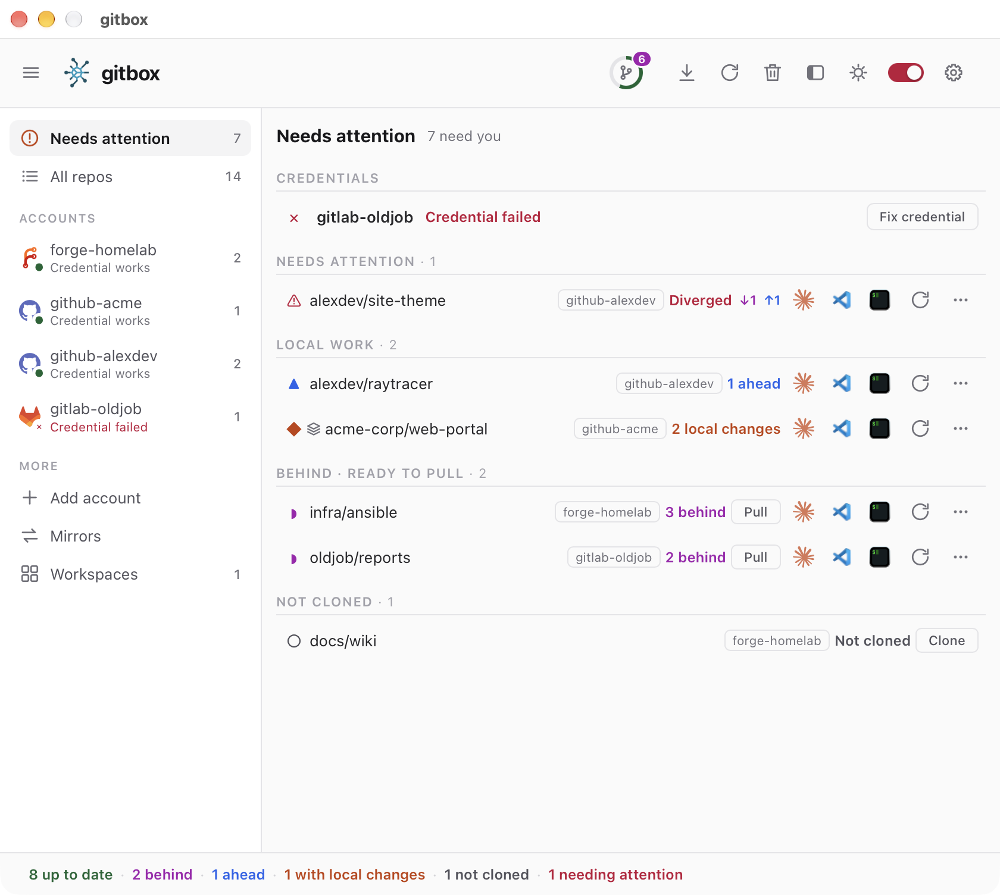
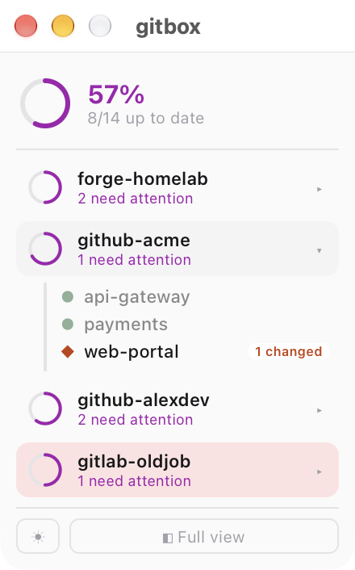
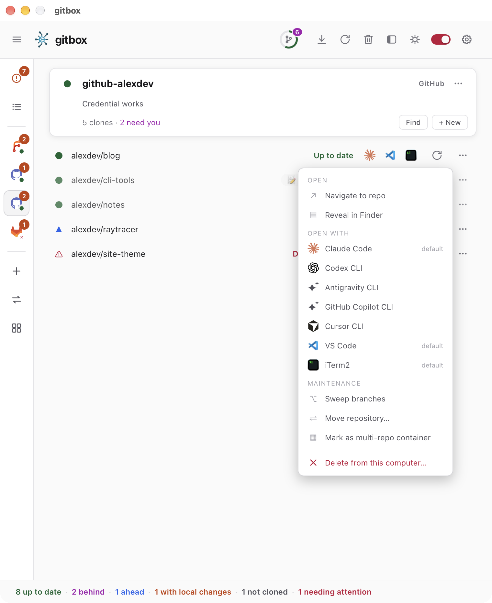

<p align="center">
  
</p>

# Gitbox desktop — guía de usuario

Gitbox es una app de escritorio que mantiene tus proyectos Git organizados y al día, incluso cuando trabajas con varias cuentas en GitHub, GitLab, Gitea, Forgejo y Bitbucket.

Esta guía cubre todo, desde el primer arranque hasta el uso diario.

## Instalación

Descarga el instalador para tu plataforma desde la página de [Releases](https://github.com/LuisPalacios/gitbox/releases):

- **Windows** — `gitbox-win-amd64-setup.exe` instala `GitboxApp.exe` en Program Files con accesos en el menú Inicio.
- **macOS** — `gitbox-macos-arm64.dmg` o `gitbox-macos-amd64.dmg`, para macOS 13 Ventura o posterior. Abre el DMG y ejecuta su script de instalación desde Terminal.
- **Linux** — `gitbox-x86_64.AppImage`, autocontenido: descárgalo y ejecútalo.

También puedes descargar un archivo ZIP (`gitbox-<platform>-<arch>.zip`) y extraerlo a mano. Cada uno contiene solo la app: `GitboxApp.exe`, `GitboxApp.app` o `GitboxApp`.

> **macOS:** Apple no firma la app. El DMG incluye un script "Install Gitbox" que copia `GitboxApp.app` a `/Applications/` y elimina los flags de cuarentena. Ejecuta `bash "/Volumes/gitbox/Install Gitbox.command"` desde Terminal. Para una instalación manual, ejecuta `xattr -cr /path/to/GitboxApp.app`.

Gitbox llama a herramientas que ya están en el sistema: **Git** en tu PATH y [Git Credential Manager](https://github.com/git-ecosystem/git-credential-manager) para las cuentas GCM. **Ajustes → Comprobación del sistema** lista lo que falte con el comando de instalación para tu SO. Consulta [Panel de ajustes](#panel-de-ajustes).

### Script de bootstrap

En macOS, Linux o Windows (Git Bash), el script de bootstrap descarga la última release e instala la app:

```bash
bash <(curl -fsSL https://raw.githubusercontent.com/LuisPalacios/gitbox/main/scripts/bootstrap.sh)
```

Usa `--version <tag>` para una release concreta o `--prefix <dir>` para cambiar el directorio de instalación (por defecto `~/bin`; macOS instala `GitboxApp.app` en `/Applications/`).

En Linux el script también registra la app en el menú Activities, para que puedas buscar "Gitbox" o arrastrarla al dock. Omítelo con `--no-desktop`, o ejecútalo más tarde por separado:

```bash
bash <(curl -fsSL https://raw.githubusercontent.com/LuisPalacios/gitbox/main/scripts/register-gitbox.sh)
```

Pasa `--uninstall` al mismo script para eliminar la entrada del menú. Las actualizaciones desde la app y las ejecuciones posteriores del bootstrap no necesitan volver a registrarla.

En Windows el setup exe y el script de bootstrap son alternativas: el setup exe instala en Program Files con una entrada en el menú Inicio; el script de bootstrap, en `~/bin` sin ninguna. Elige uno. Cuando el script de bootstrap encuentra una copia del setup exe, avisa de que el menú Inicio sigue abriendo esa copia y la deja donde está. También detecta una instalación a medio quitar (una entrada de desinstalación cuyos archivos ya no existen) e imprime los comandos para limpiarla.

Los hosts headless no pueden ejecutar la app. Ahí, `--cli-only` instala la última CLI `gitbox` 1.x de la línea de mantenimiento v1. El script la elige por su cuenta en Linux cuando no está definida ni `DISPLAY` ni `WAYLAND_DISPLAY`.

### Linux AppImage

Descarga la AppImage, dale permiso de ejecución y ejecútala:

```bash
chmod +x gitbox-x86_64.AppImage
./gitbox-x86_64.AppImage
```

La app necesita un entorno de escritorio con servidor de pantalla (X11 o Wayland).

## Paso 1: primer arranque

La primera vez que abres Gitbox, una configuración guiada corta te lleva por tres pasos:

1. **¿Dónde guardas tus proyectos?** — elige tu primera **raíz de clonado**, la carpeta donde viven tus proyectos en disco, como `~/00.git` o `C:\repos`. Puedes añadir más raíces después en Ajustes.
2. **Conecta dónde están guardados tus proyectos** — elige GitHub, GitLab, Bitbucket o la tarjeta **Forgejo** y **Gitea** (después elige cuál y escribe la dirección del servidor). Escribe tu usuario, tu nombre y tu email. El nombre y el email vienen rellenos desde tu identidad global de git cuando la tiene, y aparecen en los cambios que guardes. Haz clic en **Iniciar sesión con el navegador** e inicia sesión. Gitbox usa Git Credential Manager (GCM) para esto.
3. **Elige los proyectos que quieres descargar** — Gitbox lista los repositorios que tu cuenta puede ver. Marca los que quieras y haz clic en **Descargar**. Empiezan a clonarse en cuanto se abre la pantalla principal.

Si GCM no está instalado, el paso 2 muestra cómo instalarlo y ofrece **Usar un token**, que enlaza a la página donde creas un token y te pide pegarlo. Si el inicio de sesión falla, puedes usar **Reintentar**, cambiar a un token o volver atrás con **Cambiar los datos**.

Nunca escribes una clave de cuenta: Gitbox elige una por ti, como `github-alice`, que también es el nombre de la carpeta de la cuenta en disco. Puedes usar **Omitir por ahora** en los pasos 2 y 3 y añadir cuentas más tarde. Las instalaciones nuevas empiezan en [modo Simple](#modos-simple-y-avanzado). Si sales después del primer paso, el siguiente arranque abre la pantalla principal; termina desde **Conectar una cuenta** en la barra lateral.

En los arranques posteriores, Gitbox muestra tus clones, preferencias y la anidación de contenedores al instante, antes de que terminen las comprobaciones de estado. Los indicadores giratorios marcan los clones que todavía está comprobando o a los que está haciendo fetch.

## Paso 2: añadir cuentas

Una cuenta le dice a Gitbox quién eres en un servidor concreto, por ejemplo tu cuenta de GitHub o el GitLab de tu empresa.

En modo Simple, **Conectar una cuenta** en la barra lateral ejecuta los mismos pasos de conectar y elegir proyectos que el primer arranque. En modo Avanzado, **Añadir cuenta** abre el formulario completo, que también ofrece SSH y te deja elegir la clave de cuenta. Rellena:

1. **Clave de cuenta** — un nombre corto que eliges, como `github-personal`. También se convierte en el nombre de la carpeta en disco.
2. **Proveedor** — GitHub, GitLab, Gitea, Forgejo o Bitbucket.
3. **URL** — la dirección del servidor. Para GitHub es `https://github.com`.
4. **Usuario de Git** — tu nombre de cuenta en ese servicio.
5. **Nombre y Email** — la identidad que usan tus commits de Git.
6. **Tipo de credencial** — cómo se autentica Gitbox (ver más abajo).

### Configurar credenciales

Después de crear la cuenta, Gitbox necesita una forma de iniciar sesión en tu proveedor. Hay tres opciones:

- **GCM (Git Credential Manager)** — la más sencilla. Gitbox abre tu navegador para que inicies sesión. Es la mejor para GitHub y GitLab.
- **Token (personal access token)** — creas un token en el sitio web de tu proveedor y lo pegas en Gitbox. La app te dice qué URL visitar y qué permisos seleccionar.
- **SSH** — Gitbox genera un par de claves. Copias la clave pública y la añades a los ajustes de tu proveedor; la app te da el enlace directo.

Cuando la credencial funciona, la entrada de la cuenta en la barra lateral y su tarjeta indican **La credencial funciona** junto a una marca verde. Para los detalles de cada tipo y sus permisos, consulta [credentials.md](credentials.md).

## Paso 3: encontrar y añadir proyectos

Selecciona la cuenta en la barra lateral y haz clic en **Buscar** en su tarjeta, o elige **Buscar proyectos…** en el menú ⋯ de la cuenta. Gitbox pide a tu proveedor todos los repositorios que tu cuenta puede ver y los lista de la A a la Z.

- **Campo de búsqueda** — escribe para filtrar la lista.
- **Seleccionar todo** — selecciona todo lo visible, respetando el filtro.
- **Ya añadidos** — los repos que ya están en tu config aparecen atenuados y no se pueden seleccionar de nuevo.

Elige los que quieras y haz clic en **Añadir y Pull**. Gitbox los guarda en tu config y los clona en la raíz de clonado de la cuenta. Con dos o más raíces, primero pregunta a cuál van.

Discovery solo añade repos a tu config; nunca los elimina.

## Día a día

Cierra cualquier diálogo con **Escape** o haciendo clic fuera de él. Los diálogos ocupados o que necesitan una decisión explícita (un clon en curso, una confirmación en marcha) siguen abiertos hasta que terminan. Los nombres de cuenta, las filas de repo y las insignias de organización también responden a **Enter** y **Espacio** cuando llegas a ellos con **Tab**.

### Modos Simple y Avanzado

Gitbox tiene dos experiencias. **Simple** es para quien no conoce git y solo quiere sus proyectos a salvo. **Avanzado** muestra cada detalle y herramienta de git. Cambia de modo con el interruptor de la barra superior, a la izquierda del engranaje de ajustes: gris es Simple, rojo es Avanzado, el modo con poder destructivo. Las instalaciones nuevas empiezan en Simple; las configs anteriores a este ajuste se quedan en Avanzado. La elección se guarda como `global.ui_mode` en `gitbox.json`.

En Simple, cada proyecto responde a una pregunta, "¿está a salvo mi trabajo?", con uno de seis estados:

- **Guardado** — todo está en el servidor.
- **Trabajo en curso · N archivos a salvo aquí** — archivos cambiados en este ordenador que todavía no están en el servidor. Abre el proyecto con tu IA y pídele que los guarde.
- **Guardado aquí, sin subir** — cambios guardados que no han llegado al servidor. Pasa el ratón por encima para ver el detalle.
- **Versión nueva en línea** — el servidor tiene trabajo más nuevo. **Actualizar** solo añade la versión nueva y nunca toca tu trabajo. Gitbox nunca actualiza por su cuenta.
- **Solo en línea** — el proyecto aún no está en este ordenador. **Descargar** lo trae.
- **Necesita ayuda** — algo ha ido mal, por ejemplo cambiaron las dos copias. Haz clic en el proyecto para ver qué pasa, y ábrelo con tu IA para arreglarlo.

Los nombres se muestran sin el prefijo de la organización; pasa el ratón sobre un nombre para verlo completo. Las filas mantienen los tres [botones de lanzamiento](#acciones-de-clones), y el menú ⋯ ofrece Abrir en la web, la carpeta, los editores, los AI harnesses y **Borrar de este ordenador…**.

Simple oculta el resto: la vista Mirrors, el modo borrar, los botones de vista compacta y de tema (el tema sigue en Ajustes), las insignias de contenedor y de rama, los conteos por delante, por detrás y de cambios, y el botón de fetch de cada fila. Las insignias de tus PR abiertos (📝) y de los PR que esperan tu revisión (👀) aparecen en los dos modos. La barra superior mantiene **Comprobar todo** y **Actualizar todo**. La salud de la cuenta se lee en palabras sencillas, y **Reconectar** aparece cuando una credencial se rompe. Ajustes oculta las filas Configuración, PR / revisiones, Gitignore global y Terminales. La vista compacta es igual en los dos modos.

### Vista completa

La vista completa muestra la barra superior, la barra lateral, la vista seleccionada y el footer de resumen. La barra superior contiene los anillos de salud y los botones Pull de todo, Fetch de todo, Modo borrar, Vista compacta, tema, Simple/Avanzado y Ajustes; el logo de GitBox del extremo izquierdo pliega la barra lateral. El footer de resumen siempre muestra los conteos de repos y de mirrors.

El anillo de repos lleva un icono de rama y se llena a medida que los clones se ponen al día (en Simple, a medida que los proyectos se guardan). Una pequeña insignia cuenta lo que aún falta, y al pasar el ratón sobre el anillo se ve la línea completa `N de total al día` (Simple: `N de total guardados`). Cuando el anillo tiene algo pendiente, al hacer clic se abre **Requiere atención** (Simple: **Te necesitan**). Avanzado añade un [anillo de mirrors](#anillo-de-salud-de-mirror) cuando hay mirrors configurados.

La ventana se abre con 1040 px de ancho la primera vez y puede encogerse hasta 640 × 480. No crece más allá de la barra lateral más 1100 px de contenido, y al plegar la barra lateral su ancho pasa al contenido.

### La barra lateral

La barra lateral de la izquierda elige qué muestra el área principal:

- **Requiere atención** (Simple: **Te necesitan**) — primero las cuentas cuya credencial necesita un arreglo, cada una con su botón de arreglo, y después cada repo que te necesita, agrupados como necesita ayuda, trabajo local, por detrás y no clonado. Dentro de cada grupo, las filas quedan bajo una cabecera por cuenta, en orden alfabético. Un contenedor anida los clones que tiene al lado, como en Todos los repos; un clon cuyo contenedor está en otro grupo muestra una etiqueta "en \<parent\>". Una fila que pasa a estar bien mientras miras, después de un pull por ejemplo, se queda en su sitio, atenuada, hasta que sales de la vista. Cuando nada te necesita, la vista lo dice.
- **Todos los repos** (Simple: **Todos los proyectos**) — cada clon, agrupado por cuenta, en orden alfabético.
- **Cuentas** — una entrada por cuenta con el logo de su proveedor, una pequeña marca de salud, su nombre, su salud en palabras y cuántos repos te necesitan. Haz clic en una para abrir la vista de la cuenta.
- **Más** — bajo el separador inferior, todo lo que no es una cuenta:
  - **Añadir cuenta** (Simple: **Conectar una cuenta**) — consulta el [Paso 2](#paso-2-añadir-cuentas).
  - **Encontrados en disco** — aparece cuando Gitbox encuentra clones en disco que no ha podido ubicar por su cuenta, con cuántos son, o cuando has ignorado alguno. Abre **Clones sin ubicar** (consulta [Clones encontrados en disco](#clones-encontrados-en-disco)).
  - **Mirrors**, solo en Avanzado.

El logo de GitBox de arriba a la izquierda, o ⌘B en macOS y Ctrl+B en el resto, pliega la barra lateral a un riel de iconos. El riel mantiene los logos de los proveedores con su marca de salud y su conteo de atención; al pasar el ratón sobre uno se ven el nombre de la cuenta y su salud, y un clic cambia a ella. En una ventana de menos de 780 px la barra lateral siempre se muestra como el riel, y el logo abre la barra lateral completa sobre el contenido hasta que eliges una vista.

Gitbox recuerda la última vista y la barra lateral plegada entre reinicios. Si esa cuenta ya no existe, o Simple no puede mostrar Mirrors, se abre Requiere atención en su lugar. Renombrar una cuenta conserva su vista.

### Entender la tarjeta de cuenta

La vista de una cuenta empieza con una tarjeta de tres líneas:

1. **Marca de salud y nombre** a la izquierda; haz clic en el nombre para editar la cuenta. El proveedor y el menú ⋯ de la cuenta están a la derecha.
2. **Salud en palabras**: La credencial funciona, Funciona, con un aviso, Sin conexión · no se llega al servidor, La credencial ha fallado o Sin credencial configurada (Simple: Conectado, No se puede conectar ahora, Hay que reconectar, Sin conectar). Cuando algo necesita arreglo, el botón de la derecha lo hace: **Reintentar** vuelve a comprobar una cuenta sin conexión, y **Arreglar credencial**, **Configurar credencial** o **Reconectar** de Simple abren la pantalla de credenciales. En Avanzado, al pasar el ratón sobre las palabras se ven el tipo de credencial y sus mensajes.
3. **Conteos**: cuántos repos tiene la cuenta y cuántos te necesitan. **Buscar** descubre repos y **+ Crear** crea uno, en los dos modos. Ambos se deshabilitan, con el motivo al pasar el ratón, cuando la credencial no llega a la API del proveedor.

Cuando a un token de GitHub o GitLab que funciona le quedan 14 días o menos para caducar, la salud en palabras pasa a **El token caduca en N días** en naranja, y **Cambiar token** (Simple: **Renovar**) abre la pantalla de credenciales. La entrada de la barra lateral y su tooltip dicen lo mismo. En Avanzado, al pasar el ratón sobre las palabras también se ve la fecha de caducidad de cualquier token que la tenga. Las APIs de Gitea, Forgejo y Bitbucket no informan de la caducidad de los tokens, así que esas cuentas nunca muestran este aviso.

Una credencial ausente o rota tiñe la tarjeta de rojo claro, y un aviso la tiñe de naranja. Los clones de la cuenta siguen a la tarjeta, en orden alfabético. Un clon anidado en el contenedor de otra cuenta aparece aquí con una etiqueta "en \<parent\>"; **Todos los repos** lo mantiene bajo su contenedor, mientras que sus acciones siguen usando su propia cuenta.

### Contraer y expandir

La vista **Todos los repos** se pliega a dos niveles, y la vista de una cuenta también pliega los clones padre:

- **Grupos de cuenta** — cada cuenta va en su propia tarjeta suave, aquí y en **Requiere atención**. Su nombre, en mayúsculas y en el color de su proveedor (GitHub índigo, GitLab naranja, Gitea verde, Forgejo rojo, Bitbucket azul), queda en la columna de los puntos de estado de debajo, junto al triángulo ▾ relleno que cuelga a su izquierda. Haz clic en la barra de cabecera o en el nombre para plegar su lista de clones. La cabecera siempre muestra cuántos clones contiene y cuántos requieren atención, plegada o no, así que un problema nunca queda oculto tras un pliegue. El menú ⋯ de la cabecera sigue funcionando y nunca pliega el grupo.
- **Clones con clones debajo** — un clon que tiene clones anidados o carpetas de workspace aún sin clonar bajo él muestra un chevron ▾ de línea en lugar de su punto de estado, así que su nombre queda alineado con el de sus hermanos; sus palabras de estado siguen diciendo cómo está. Haz clic en el chevron para plegar todo lo que hay debajo, a cualquier profundidad. Cuando el clon tiene actualizaciones, cambios locales u otros detalles que revisar, su nombre abre el panel de detalle; en caso contrario, su nombre también pliega los hijos. Una fila plegada muestra cuántas filas oculta y cuántas de ellas requieren atención.

Gitbox recuerda lo que pliegas entre reinicios (`global.collapsed` en `gitbox.json`) y olvida las entradas de cuentas o clones que borras o renombras. La vista compacta mantiene su propia expansión por cuenta.

### Mantener proyectos sincronizados

#### Comprobación automática

Gitbox vigila tus proyectos y muestra su estado:

- **Al día** (verde) — coincide con el remoto.
- **N por detrás** (magenta) — el remoto tiene N commits nuevos que puedes traer.
- **N cambios locales · protegidos** (naranja) — tienes trabajo sin commitear, y nada en Gitbox lo toca.
- **N por delante** (azul) — tienes N commits que no has subido con push.
- **Divergido**, **Conflicto**, **Upstream eliminado** y **Error** (rojo) — el repo necesita una revisión; haz clic en él para ver los detalles.
- **No clonado** (gris) — el repo todavía no está en este ordenador; **Clonar** lo descarga.
- **Raíz no disponible** (gris; Simple: **Carpeta no encontrada**) — su raíz de clonado no está, por ejemplo un disco desconectado. No se pierde nada: el repo vuelve cuando vuelve la raíz.
- **Rama local** (verde) — en una feature branch sin upstream tracking, lo cual es normal.
- **No upstream** (gris) — la rama predeterminada no tiene upstream tracking y requiere atención.

Los clones aparecen siempre en orden alfabético del nombre que muestra la fila, también los anidados. Cuando alguna fila de una lista te necesita, las filas sin nada que hacer se atenúan ligeramente hasta que pasas el ratón por encima, para que los problemas destaquen.

Un repo con checkout en una rama no predeterminada muestra una pequeña insignia de rama junto a su nombre, como `feature-xyz`. Un detached HEAD muestra una insignia roja `desacoplado`.

#### Pull de todo

Haz clic en **Pull de todo** (icono de flecha hacia abajo) en la barra superior para ponerlo todo al día. Clona los repos ausentes y hace pull de los repos que están por detrás solo con avance rápido (`git pull --ff-only`), así que nunca fusiona y nunca toca los cambios locales. El botón **Pull · solo FF** propio de una fila por detrás hace lo mismo para un repo. En Simple, el botón es **Actualizar todo**.

#### Fetch de todo

Haz clic en **Fetch de todo** (icono ↻) para consultar todos los remotos en busca de commits nuevos sin hacer pull. Los indicadores de estado se actualizan para que veas qué cambió antes de hacer pull. En Simple, el botón es **Comprobar todo**.

#### Tarjetas de actividad y de resultado

Mientras se ejecuta Fetch de todo o Pull de todo, una tira bajo la barra superior dice qué abarca, como "Haciendo fetch de 17 clones en 3 cuentas" o "Haciendo pull de 2 (solo avance rápido) y clonando 1", con una barra de progreso. Cuando termina, una tarjeta de resultado en la esquina inferior derecha lo resume: a cuántos clones hizo fetch, cuántos están ahora por detrás y listos para pull, cuáles omitió porque su cuenta está sin conexión, cualquier fallo con el primer error, y que los cambios locales quedaron intactos. Las tarjetas de éxito desaparecen tras unos segundos; una tarjeta con un fallo se queda hasta que la cierras. Los fetch del arranque y los periódicos solo dejan tarjeta cuando algo cambió o falló.

Otras acciones informan de sus errores de la misma forma, por ejemplo una herramienta que no se abre o un mirror que no se puede añadir.

#### Fetch periódico

**Ajustes → Comprobación periódica** (Simple: **Buscar cambios**) hace fetch de todos los remotos cada 5, 15 o 30 minutos y vuelve a comprobar la salud de las credenciales en segundo plano.

Las comprobaciones del arranque, las periódicas y las manuales comparten un único ciclo de refresco. El estado local aparece en cuanto terminan las comprobaciones de Git; el indicador de fetch sigue activo hasta que terminan también las comprobaciones de credenciales y de proveedores. Un proveedor lento o inaccesible nunca convierte un clon conocido en un upstream ausente. Si Gitbox no puede restaurar la identidad, el origin o el aislamiento de credenciales configurados de un clon, muestra un aviso y omite el fetch de ese clon.

#### Ver detalles

Haz clic en el nombre de un repo que muestre actualizaciones disponibles, cambios locales, conflictos u otros problemas. Un panel se abre justo debajo de su fila; haz clic otra vez en el nombre para cerrarlo. En Simple y Avanzado puedo revisar:

- La rama actual y cuántos commits voy por delante o por detrás (solo Avanzado).
- Cada commit entrante, del más reciente al más antiguo, con su autor y mensaje. Son los commits del upstream de la rama actual que mi rama local no contiene.
- Cada archivo cambiado, con un icono de lo que ocurrió (añadido, eliminado, renombrado, modificado).
- Cualquier archivo sin seguimiento.

El panel mantiene un tamaño compacto y permite recorrer la lista completa con scroll. Conserva los detalles de los archivos pendientes junto a los commits entrantes cuando existen ambos. La lista refleja la última comprobación de actualizaciones; **Comprobar todo** (Avanzado: **Fetch de todo**) la refresca. Abrir el panel no ejecuta fetch ni pull, y **Actualizar** sigue siendo la acción explícita que incorpora los cambios entrantes al clon.

El panel se refresca cuando Gitbox detecta cambios nuevos y se cierra cuando el clon ya no requiere atención. Cambiar de repositorio mientras cargan los detalles nunca sustituye la nueva selección por un resultado anterior.

### Vista compacta

Haz clic en **◧** en la barra superior para cambiar al modo compacto, una tira estrecha de estado de unos 220 px de ancho:

- **Anillo de salud global** — porcentaje y conteo global de sincronización.
- **Píldoras de cuenta** — una por cuenta con un mini anillo y un conteo de problemas. Haz clic en una para ver sus repos.
- **Píldora de mirrors** — cuando hay mirrors configurados, el conteo active/total con un punto de color.
- **Selector de tema** y un botón **◧ Vista completa** abajo.

Así puedes tener Gitbox visible junto a otras apps. El modo compacto solo muestra el estado: vuelve a la vista completa para llegar a las acciones de clones y de cuentas.

<p align="center">
  
</p>

### Clones encontrados en disco

Gitbox mantiene `gitbox.json` al día con los clones bajo tus raíces de clonado. Lo comprueba al arrancar, cuando la ventana recupera el foco, tras un **Fetch de todo** manual y cuando cambian las raíces:

- **Los clones nuevos que reconoce** se añaden solos, en su sitio; Gitbox nunca los mueve. Un clon cuenta como reconocido cuando exactamente una cuenta coincide con él y algo más allá del servidor lo confirma: el owner es el usuario de la cuenta, está bajo la carpeta de esa cuenta en una raíz, o su URL remota o su `credential.<url>.username` nombra la cuenta.
- **Clones movidos** — cuando la carpeta de un repo seguido ha desaparecido pero aparece un clon del mismo repo en otro lugar bajo una raíz, Gitbox apunta la entrada al nuevo sitio en lugar de listarlo dos veces.
- **Los clones borrados** siguen listados como **No clonado**, para que puedas clonarlos de nuevo o borrar la entrada.
- **Los repos bajo una raíz que falta** se leen como **Raíz no disponible** y se dejan en paz hasta que la raíz vuelve.

Para cada clon añadido, Gitbox configura el aislamiento de credenciales por repo, fija `user.name` y `user.email` a partir de la cuenta y reescribe la URL remota para que coincida con el tipo de credencial.

Todo lo demás espera en **Clones sin ubicar**, que se abre desde **Encontrados en disco** en la barra lateral. Cada fila dice por qué Gitbox no ha podido ubicarlo:

- **solo coincide el servidor** — una cuenta en ese servidor, pero nada más vincula el clon a ella, como el proyecto de otra persona clonado para leerlo.
- **coinciden varias cuentas** — dos o más cuentas en el mismo servidor empatan.
- **ninguna cuenta en este servidor**
- **sin remoto** — sin `origin`.
- **ya gestionado en otra ruta** — un segundo checkout de un repo que Gitbox ya sigue.
- **un worktree de git de otro clon**

Donde una cuenta puede aplicarse, elígela y haz clic en **Adoptar**; el clon se une a esa cuenta en su sitio. **Ignorar** oculta un clon para siempre, y **Mostrar ignorados** lista los ignorados, donde todavía puedes **Adoptar** uno o usar **Dejar de ignorar**. Las rutas ignoradas se guardan en `global.ignored_clones`. Las reglas de puntuación detrás del emparejamiento de cuenta están en [Arquitectura › pkg/adopt](architecture.md#pkgadopt--discovery-de-repos-huérfanos).

## Acciones de repo y de cuenta

### Acciones de clones

Cada fila de repo clonado tiene tres botones de lanzamiento, en los dos modos: tu primer AI harness, tu primer editor y tu perfil de terminal predeterminado. Cada uno muestra el logo de la herramienta cuando Gitbox lo conoce (Claude, Codex, Gemini, Cursor, VS Code, Zed y cada app de terminal que Gitbox detecta) o un icono genérico, y su nombre al pasar el ratón.

Junto a ellos, el **menú ⋯** es una lista plana por secciones, sin submenús:

1. **Abrir** — **Ir al repo** abre el repo en el proveedor, y **Mostrar en Finder** (el Explorador, o el gestor de archivos en Linux) abre su carpeta.
2. **Abrir con** — cada AI harness y editor, y después el perfil de terminal predeterminado y los marcados como Preferido, cada uno con su logo. La herramienta que usa el botón de lanzamiento propio de la fila lleva una etiqueta **predeterminado**.
3. **Mantenimiento** (Avanzado) — **Limpiar ramas**, **Mover repositorio…**, **Marcar como contenedor multi-repo** o **Desmarcar como contenedor multi-repo**, **Elegir workspace…** en un contenedor con archivos de workspace, y **Volver a buscar clones anidados**.
4. **Borrar de este ordenador…** — en los dos modos.

<p align="center">
  
</p>

El editor y el AI harness predeterminados son las primeras entradas de `global.editors` y `global.ai_harnesses` en `gitbox.json`; reordena esos arrays para cambiarlos, y el menú sigue el orden de la config. La terminal predeterminada es el perfil marcado como Predeterminado en **Ajustes → Terminales → Gestor** (consulta [Editores y perfiles de terminal](#editores-y-perfiles-de-terminal)).

Cuando el clon no ha terminado o su estado todavía no se ha cargado, las entradas de carpeta, editor, terminal y AI harness dicen que primero hay que clonar en lugar de no hacer nada.

**🧹 Limpiar ramas** encuentra y elimina ramas locales obsoletas. Un diálogo de confirmación las lista antes de eliminar nada, y la rama actual y la rama predeterminada nunca se tocan. Detecta tres tipos:

- **Eliminadas** — la rama de remote tracking se eliminó, por ejemplo después de fusionar una PR y borrar su rama en el servidor. Se elimina con `git branch -D`.
- **Fusionadas** — totalmente fusionadas en la rama predeterminada. Se eliminan con `git branch -d`.
- **Squashed** — fusionadas con squash o con rebase en el servidor (commits distintos, mismos cambios). Se eliminan con `git branch -D`.

### Acciones de cuenta

Cada cuenta tiene un **menú ⋯**: en su tarjeta en la vista de la cuenta, y en la cabecera de su grupo en **Todos los repos**. Usa las mismas secciones que el menú de repo, aplicadas a la carpeta de la cuenta (`<root>/<account-key>`, en la raíz de clonado de la cuenta) en lugar de a un clon concreto:

- **Ir a la cuenta** — abre la página de perfil o de grupo de la cuenta en el proveedor, como `https://github.com/<username>`.
- **Mostrar en Finder** (el Explorador, o el gestor de archivos) — abre la carpeta de la cuenta, útil para búsquedas entre repos y ediciones multi-repo.
- **Abrir con** — las mismas entradas de AI harness, editor y terminal que el menú de repo, abiertas en la carpeta de la cuenta. Aquí no hay Limpiar ramas.
- **Cuenta** — **Buscar proyectos…** y **Crear repo…**, deshabilitadas cuando la credencial no llega a la API del proveedor; **Editar cuenta…**; y **Cambiar credencial…** en Avanzado, o **Reconectar…** en Simple cuando la credencial está rota.

La carpeta de la cuenta solo existe cuando hay algo clonado bajo la cuenta. Hasta entonces, las entradas de carpeta y editor no hacen nada y las de terminal y AI harness muestran "account folder does not exist", así que clona al menos un repo primero.

### Editores y perfiles de terminal

Gitbox detecta VS Code y Zed en tu PATH al arrancar y los escribe en `global.editors` con sus rutas completas. Añade cualquier otro editor a mano con su `name` y su `command`. Cursor y otros IDE agénticos aparecen entre los [AI harnesses](#acciones-de-ai-harness), no entre los editores.

Las terminales usan perfiles. Al arrancar, Gitbox detecta las apps de terminal y los shells instalados, los escribe en `global.terminal_apps` y `global.shells`, y los combina en perfiles lanzables en `global.terminal_profiles`:

- **Windows** — terminales: Windows Terminal, WezTerm, Alacritty, Tabby, ConEmu, Hyper, Mintty y ZOC. Shells: PowerShell 7 y 5, Command Prompt, Git Bash y WSL. Un perfil empareja una terminal con un shell, por ejemplo `Windows Terminal — PowerShell 7`.
- **macOS** — iTerm2, Terminal, Warp, Kitty, Ghostty, WezTerm y Alacritty. Un perfil es solo la terminal y ejecuta tu login shell (Zsh, Bash, Fish o Dash).
- **Linux** — GNOME Terminal, Konsole, Terminator, Foot, Alacritty, Kitty, Tilda, Guake y xterm. Un perfil es solo la terminal y ejecuta tu login shell (Bash, Zsh, Fish, Ksh o Dash).

**Ajustes → Terminales → Gestor** abre el editor de perfiles en su propia ventana, que se cierra con la ventana principal. Lista las apps de terminal y los shells detectados (solo lectura) y los perfiles. En cada perfil puedes:

- Marcarlo como **Predeterminado** (el botón de terminal de la fila y la etiqueta **predeterminado** del menú), **Preferido** (listado bajo **Abrir con**) u **Oculto**.
- Editar su nombre, su terminal y su shell, añadir tus propios perfiles o eliminar los que añadiste.
- Hacer clic en **Volver a detectar** para recoger shells, terminales o entradas `launch_menu` de WezTerm nuevos sin reiniciar.

La re-detección conserva tus flags, renombrados, args editados a mano y los perfiles que añadiste. Para pasar flags extra a un perfil, edita sus `args` en `gitbox.json`.

En Windows, los perfiles de shell desnudo que abren un shell sin app de terminal (`pwsh.exe`, `powershell.exe`, `cmd.exe`, `wsl.exe`) están ocultos por defecto y solo aparecen por sí mismos cuando no hay ninguna terminal moderna instalada. Muestra uno en el Gestor para tener un acceso directo.

#### Perfiles de Windows Terminal y WezTerm

Estas dos terminales se lanzan a través de tu propia configuración de terminal cuando pueden, así que el shell se abre con la fuente, los colores y los ajustes de arranque que configuraste allí.

- **Windows Terminal** — un perfil coincide con el perfil de WT que tiene el mismo nombre de shell, como `PowerShell 7`, o con el de esa distro WSL. Se abre como pestaña nueva en tu ventana de WT más reciente. Los perfiles de WT ocultos y los de una fuente de perfiles desactivada nunca coinciden. Gitbox lee `settings.json` de la instalación de la Store (`%LOCALAPPDATA%\Packages\Microsoft.WindowsTerminal_8wekyb3d8bbwe\LocalState\`), después de Preview y después de la instalación sin empaquetar (`%LOCALAPPDATA%\Microsoft\Windows Terminal\`), y recoge los cambios en el siguiente lanzamiento.
- **WezTerm** — en todos los SO, cada entrada de `config.launch_menu` en `wezterm.lua` se convierte en un perfil, y al lanzarlo se ejecutan los `args` propios de esa entrada. Los callbacks de selector en Lua (`color_scheme` por entrada, hooks de `mux.spawn_window`) no se ejecutan, porque solo se disparan cuando eliges la entrada desde el propio launcher de WezTerm.

Sin coincidencia, Gitbox usa los argumentos de lanzamiento genéricos de la terminal. Las reglas de emparejamiento están en [Arquitectura › Cómo funciona el emparejamiento de lanzamiento](architecture.md#cómo-funciona-el-emparejamiento-de-lanzamiento).

### Acciones de AI harness

Los AI CLI harnesses (Claude Code, Codex, Antigravity, Aider, Cursor Agent, OpenCode, …) son programas interactivos que necesitan una terminal. Cada uno que encuentra Gitbox aparece bajo **Abrir con** en los menús ⋯ de repo y de cuenta, y el primero es el botón de lanzamiento de IA de la fila.

Al hacer clic en uno se abre el **perfil de terminal predeterminado** en la carpeta y se ejecuta el harness dentro del shell de ese perfil. Se aplican los archivos de arranque y el PATH de tu shell (`nvm` y `npm` en macOS y Linux, Git Bash en Windows), y acabas en un prompt interactivo cuando el harness termina. Los perfiles emparejados de Windows Terminal y WezTerm mantienen su fuente y sus colores. Para cambiar de host, marca otro perfil como Predeterminado en **Ajustes → Terminales → Gestor**.

En macOS, Terminal e iTerm2 ejecutan el harness mediante AppleScript, así que la primera ejecución puede pedir permiso de Automation. Warp, Kitty, Ghostty y Alacritty en macOS no pueden ejecutar un comando al lanzarse: con uno de ellos como perfil predeterminado, una entrada de harness muestra un error con el nombre del perfil. Marca iTerm2, Terminal o WezTerm como Predeterminado en su lugar.

Gitbox busca harnesses en segundo plano poco después de abrirse la ventana, cada diez minutos y cuando la ventana recupera el foco, así que una herramienta recién instalada aparece sin reiniciar. Además de PATH, busca en `~/.local/bin`, en los prefijos de Homebrew en macOS y en carpetas de instalación propias de cada herramienta, como `%LOCALAPPDATA%\agy\bin` para Antigravity en Windows. Los harnesses encontrados van a `global.ai_harnesses`, cada uno con un `name`, un `command` y un array opcional `args` para los flags del harness, como `["--model", "sonnet-4.6"]`.

Cuando desinstalas un harness, desaparece del menú pero se queda en la config, así que reinstalarlo, incluso en otro sitio del disco, lo devuelve con tus `args`. Las entradas que añades a mano se ocultan igual cuando su `command` deja de resolverse, pero Gitbox nunca las reescribe. La lista de herramientas que busca Gitbox se describe en [Directorio de herramientas agénticas](agentic-tools-directory.md).

### Crear repositorios

Haz clic en **+ Crear** en la tarjeta de la cuenta, o elige **Crear repo…** en el menú ⋯ de la cuenta, para crear un repositorio en el proveedor sin salir de Gitbox. El diálogo pide:

- **Propietario** — tu usuario personal más las organizaciones que informa la API del proveedor.
- **Nombre** — solo se permiten `a-z`, `A-Z`, `0-9`, `.`, `_` y `-`. Los demás caracteres se eliminan, y los espacios se convierten en guiones mientras escribes.
- **Descripción** — un resumen opcional de una línea.
- **Privado** — marcado por defecto. Desmárcalo para un repo público.
- **Clonar después de crear** — marcado por defecto. Gitbox añade entonces el repo a tu config y lo clona al momento, y el botón dice **Crear y clonar** en lugar de **Crear**.
- **Raíz de clonado** — aparece cuando tienes dos o más raíces de clonado y la casilla de clonar está marcada. Por defecto es la raíz de la cuenta.

La creación funciona con todos los proveedores y tipos de credencial, con el mismo token de API que usa discovery.

### Editar una cuenta

Haz clic en el nombre de la cuenta en su tarjeta, o elige **Editar cuenta…** en el menú ⋯ de la cuenta. Puedes cambiar:

- **Clave de cuenta** — al renombrarla, Gitbox renombra la carpeta en disco, actualiza tus claves SSH y tu config, migra los tokens guardados y corrige todas las referencias internas.
- **Proveedor** — por si elegiste el equivocado.
- **Todos los demás campos** — URL, usuario, nombre, email, rama predeterminada.

### Gestionar credenciales

Elige **Cambiar credencial…** en el menú ⋯ de la cuenta para abrir la pantalla de credenciales. Cuando la credencial necesita un arreglo, el botón de la tarjeta de la cuenta y el de Requiere atención abren la misma pantalla; en Simple, el menú ofrece **Reconectar…** en su lugar, y solo cuando la credencial está rota. Para cada tipo de credencial y sus permisos, consulta [credentials.md](credentials.md).

#### Cambiar tipo de credencial

Elige GCM, Token o SSH en el desplegable y haz clic en **Configurar**. Gitbox elimina la credencial antigua y sus artefactos, configura la nueva y reconfigura todos los clones existentes.

#### Eliminar una credencial

Mientras ves el tipo de credencial actual, haz clic en el botón rojo **Eliminar** para borrar todos los datos de autenticación guardados, por ejemplo para empezar limpio después de que caducara un token. La tarjeta se vuelve entonces roja e indica **Sin credencial configurada**; haz clic en **Configurar credencial** para empezar de nuevo.

### Mover un repositorio entre cuentas / proveedores

Abre el menú ⋯ de una fila de repo y elige **Mover repositorio…** bajo **Mantenimiento**. La entrada está deshabilitada, con el motivo al pasar el ratón, salvo que el clon esté limpio y sincronizado. El diálogo tiene tres etapas:

1. **Formulario** — elige la cuenta y el propietario de destino (personal o una organización), confirma el nombre nuevo del repo, define la visibilidad y, opcionalmente, elimina el repo de origen y el clon local después de un movimiento correcto. Las dos opciones de eliminar empiezan desmarcadas.
2. **Confirmación** — un resumen con borde rojo lista cada efecto destructivo. Escribe la clave del repo de origen, como `acme/widget`, para desbloquear **Mover**.
3. **Progreso** — cada fase (preflight → fetch → create destination → push mirror → rewire origin → optional deletes → update config) aparece como una línea propia con su estado en vivo.

El movimiento conserva cada ref y cada tag (`git push --mirror`), apunta `origin` del clon local a la URL nueva y mueve el repo a la cuenta de destino en tu config. Si falla eliminar el repo de origen o el clon local, recibes un aviso; el movimiento en sí ya está hecho.

Los dos lados necesitan los scopes de token que se listan en [Scopes de token por capacidad](credentials.md#scopes-de-token-por-capacidad).

### Eliminar repos y cuentas

Haz clic en el **icono de papelera** de la barra superior para entrar en el modo borrar. Aparecen botones ✕ rojos en la tarjeta de cuenta de la vista de una cuenta, en las tarjetas de grupo mirror y en las filas de repo; haz clic en uno para quitar ese elemento. Eliminar una cuenta también elimina sus carpetas de clones locales. Haz clic de nuevo en el icono de papelera para salir del modo borrar.

## Mirrors

Los mirrors mantienen copias de seguridad de repos en otro proveedor, por ejemplo haciendo push desde un Forgejo de homelab a GitHub. Los proveedores replican los repos en el lado del servidor mediante sus APIs; nada se clona en local. Los mirrors son opcionales y están disponibles en Avanzado.

### La vista Mirrors

**Mirrors** bajo **Más** en la barra lateral abre la vista: una cabecera con los botones **Descubrir** y **Comprobar todo**, las tarjetas de grupos mirror y, debajo, la lista de detalle de mirrors.

### Tarjetas de mirror

Cada grupo mirror se muestra como un chip (punto de estado y par de cuentas) que se abre en una tarjeta; haz clic fuera de ella o pulsa **Escape** para volver a plegarla. La tarjeta muestra:

- **Punto de estado** — verde cuando todos los repos están activos, rojo cuando hay errores, ámbar en caso contrario.
- **Etiqueta MIRROR** con los mirrors `active/total` del grupo, con el color del punto.
- **Par de cuentas**, como `forgejo ↔ github`.
- **Comprobar** — verifica el estado de sincronización comparando los commits HEAD de los dos lados.

Un chip **+** después de las tarjetas crea un grupo mirror nuevo.

### Anillo de salud de mirror

Cuando hay mirrors configurados, la barra superior muestra un segundo anillo con un icono de dos flechas junto al anillo de repos. Se llena a medida que los mirrors pasan a activos y se vuelve rojo si algún mirror tiene errores. Su insignia cuenta los mirrors que no están activos, al pasar el ratón se ve la línea `active/total`, y al hacer clic se abre **Mirrors**.

### Acciones de mirror

- **Descubrir** — escanea todos los pares de cuentas en busca de mirrors existentes, con confianza decreciente: API de push mirror (confirmed), flag de pull mirror (likely) y coincidencia de nombre (possible). Una barra de progreso muestra el avance de cada cuenta. Los repos que ya están en tu config se marcan como **configurado** y aparecen atenuados. Añade los demás uno a uno con **+ Añadir**, o todos a la vez con **Aplicar a la configuración**.
- **Comprobar todo** — comprueba el estado de sincronización de cada grupo mirror.

### Lista de detalle de mirror

Bajo las tarjetas, cada grupo lista sus repos replicados con:

- La dirección, como `origin → backup (mirror)`.
- El estado de sincronización, como Sincronizado OK o La copia va por detrás del origen.
- Un icono de aviso cuando el repo de copia es público.
- **Configurar** para los repos que todavía no se han configurado mediante la API.
- **+ Repo** para añadir repos al grupo.

## Workspaces de VS Code y contenedores multi-repo

Un **contenedor multi-repo** es un clon que contiene otros clones en su árbol de trabajo, por ejemplo un repo de proyecto cuyo `.code-workspace` agrupa varios clones hermanos. Los workspaces viven en la lista de clones, en el contenedor que los contiene; no hay una vista de workspaces aparte. Gitbox nunca crea, edita ni borra archivos `.code-workspace`: son tuyos.

### Los archivos de workspace crean contenedores

Un clon con un archivo `.code-workspace` en su raíz se convierte en contenedor por su cuenta, y Gitbox registra ese archivo en `repo.workspace`. Cuando la raíz contiene dos o más, Gitbox pregunta con cuál se abre el contenedor. Hasta que eliges, la fila muestra un aviso **elegir workspace**, y **Elegir workspace…** en el menú ⋯ lo cambia más tarde. Gitbox recuerda tu elección en `repo.workspace_preferred`: si ese archivo desaparece, otro archivo de la raíz ocupa su lugar, y cuando vuelve el contenedor lo abre de nuevo sin preguntar. Un icono 📁 marca un contenedor, y al pasar el ratón sobre él se ve el nombre de su archivo de workspace.

Gitbox comprueba al arrancar, cuando la ventana recupera el foco, tras un Fetch de todo manual y después de que cambies las raíces de clonado, así que un archivo de workspace nuevo convierte su clon en contenedor la próxima vez que vuelvas a Gitbox. Si el archivo desaparece, Gitbox borra `repo.workspace` y mantiene el contenedor.

### Clones bajo un contenedor

Cada clon dentro del árbol de trabajo de un contenedor aparece debajo de él, sangrado, y se pliega con él. Gitbox los busca hasta la **profundidad de escaneo anidado** por debajo del contenedor, y en cada carpeta que lista el archivo de workspace del contenedor, a cualquier profundidad. Los clones anidados se unen a su cuenta y organización reales en su sitio, se guardan con una `clone_folder` absoluta dentro del contenedor y nunca se mueven. Una carpeta que el archivo de workspace lista dentro del contenedor y que todavía no está en disco aparece como una fila atenuada **sin clonar** con su ruta, salvo que esté dentro de otro clon, como un submódulo sin hacer checkout. Las carpetas que el workspace lista fuera del contenedor mantienen su sitio normal bajo su propia cuenta.

Los nombres de un contenedor con archivo de workspace, de los clones que ese archivo lista y de sus carpetas sin clonar aparecen en azul, así ves de un vistazo lo que abre VS Code. Un clon anidado que el workspace no lista mantiene el color normal.

### Abrir un contenedor

En un contenedor con archivo de workspace, el botón de editor abre el archivo `.code-workspace` en lugar de la carpeta cuando el editor es VS Code o un fork suyo (VS Code Insiders, VSCodium, Cursor, Windsurf). Los demás editores abren la carpeta. Los editores del menú ⋯ se comportan igual.

### Contenedores sin archivo de workspace

Puedes marcar un clon sin archivo de workspace desde el menú ⋯ de la fila del repo, bajo **Mantenimiento**: **Marcar como contenedor multi-repo**, **Desmarcar como contenedor multi-repo** y **Volver a buscar clones anidados** una vez que es contenedor. Un contenedor con archivo de workspace no tiene la entrada Desmarcar, porque el archivo es lo que lo convierte en contenedor. El diálogo **Raíces de clonado** de Ajustes fija la **profundidad de escaneo anidado**: cuántos niveles por debajo de un contenedor busca Gitbox, por defecto 1 (los hijos inmediatos del contenedor).

El layout estándar es `<root>/<account>/<org|user>/<repo>`. Un clon encontrado en ese sitio bajo cualquier raíz de clonado se adopta en su sitio bajo esa raíz. Un clon encontrado en otro lugar de una raíz también se añade donde está, con una `clone_folder` absoluta. Gitbox nunca mueve un clon.

## Ajustes y mantenimiento

### Panel de ajustes

Haz clic en el **icono de engranaje** para abrir el panel de ajustes:

- **Configuración** — la ruta a tu archivo de config, con un botón **Abrir en editor**.
- **Raíces de clonado** — las carpetas donde viven los proyectos, la predeterminada primero, con un botón **Cambiar** (consulta [Raíces de clonado](#raíces-de-clonado)).
- **Idioma** — English o Español. El cambio se aplica al momento.
- **Tema** — Sistema, Claro u Oscuro.
- **Comprobación periódica** (Simple: **Buscar cambios**) — el intervalo de fetch automático: No, 5m, 15m o 30m.
- **Ejecutar al inicio** — abre Gitbox al iniciar sesión, donde la plataforma lo permite.
- **PR / revisiones** — muestra insignias de tus PR abiertos y de los PR que esperan tu revisión, con **Incluir borradores** para contar los PR en borrador.
- **Gitignore global** — la comprobación automática de `~/.gitignore_global` al arrancar (consulta [Aviso de gitignore global](#aviso-de-gitignore-global)).
- **Comprobación del sistema** — **Ejecutar** abre un informe de cada herramienta externa que usa Gitbox (`git`, `git-credential-manager`, `ssh`, `ssh-keygen`, `ssh-add` y `wsl` en Windows): dónde está instalada, su versión y un comando de instalación para cualquier cosa ausente que tu config necesite. Cada herramienta se marca como ok, missing (requerida por tu config) u optional. El informe también lista los hallazgos de permisos del directorio y los archivos de credenciales, con la ruta, el problema y la acción sugerida. **Volver a comprobar** repite ambas comprobaciones sin cambiar permisos.
- **Terminales** — **Gestor** abre el editor de perfiles de terminal (consulta [Editores y perfiles de terminal](#editores-y-perfiles-de-terminal)).
- **Versión** — la versión actual de la app.
- **Autor** — el autor del proyecto y un enlace al repositorio de GitHub.

Al arrancar, Gitbox comprueba los permisos de las credenciales sin leer el contenido de los tokens. Si detecta exposición, aparece un aviso sobre el panel, incluida la vista Compacta, que abre Comprobación del sistema. La auditoría informa de problemas y permisos que no puede verificar; nunca los repara automáticamente. Consulta [Permisos de los archivos de credenciales](credentials.md#permisos-de-los-archivos-de-credenciales).

Los flujos de añadir cuenta y cambiar credencial ejecutan la misma comprobación de herramientas: si eliges el tipo de credencial `gcm` en una máquina sin Git Credential Manager, un banner amarillo muestra el comando de instalación en lugar de un fallo de autenticación críptico más tarde.

### Raíces de clonado

Gitbox guarda los clones bajo una o más **raíces de clonado**, por ejemplo `~/00.git` para el trabajo diario y un disco más grande para proyectos grandes. Cada clon vive en `<root>/<account>/<org|user>/<repo>`. La primera raíz es la predeterminada, y las cuentas nuevas clonan en ella.

Abre **Ajustes** y luego **Cambiar** junto a **Raíces de clonado** para gestionarlas. Cada fila muestra la carpeta, cuántos repos viven bajo ella y una insignia **Predeterminada** en la predeterminada. Una raíz que no está en disco aparece tachada.

- **+ Añadir raíz…** — elige una carpeta; Gitbox la crea si no existe.
- **Hacer predeterminada** — las cuentas nuevas clonan en esta raíz a partir de ahora. Las cuentas que ya usan la predeterminada anterior siguen en ella, y ningún clon se mueve.
- **✕** — quita una raíz. Cuando todavía viven repos bajo ella, Gitbox pregunta si olvidarlos; sus archivos se quedan en disco.

Con dos o más raíces, un clonado explícito pregunta una vez adónde va: el **Clonar** de una fila (Simple: **Descargar**), **Buscar → Añadir y Pull** y los proyectos que eliges al añadir una cuenta. La opción por defecto es la raíz de la cuenta, y la cuenta la recuerda para su siguiente clonado. **Crear repositorio** muestra la misma opción como un campo. **Pull de todo** nunca pregunta: los clones ausentes van a la raíz de su cuenta.

El mismo diálogo fija la **profundidad de escaneo anidado** para los [contenedores multi-repo](#contenedores-sin-archivo-de-workspace).

### Notificación de actualización

Gitbox comprueba si hay actualizaciones al arrancar y cada seis horas mientras está abierto. Cuando hay una versión más nueva, aparece una píldora ámbar a la derecha del footer con la nueva versión. Haz clic en ella para descargar y aplicar la actualización en su sitio. Gitbox verifica la firma y el checksum de la release y rechaza una actualización que falle cualquiera de las dos comprobaciones; consulta [Firma de releases](release-signing.md). Reemplaza solo lo que ya está instalado junto a la app (en macOS, el bundle `GitboxApp.app` completo) y se reinicia en la nueva versión. Si la nueva versión no puede arrancar por su cuenta, la píldora lo indica: haz clic en **Salir** y vuelve a abrir la app. La píldora aparece en cada arranque hasta que actualizas; la ✕ la oculta hasta el siguiente arranque.

La AppImage de Linux solo avisa: al hacer clic en la píldora se abre la página de la release, y tú descargas la nueva AppImage y sustituyes el archivo antiguo.

El actualizador sigue la release que GitHub marca como latest, así que una GUI v1 pasa a v2 de la misma forma.

### Aviso de identidad global

Si tu `~/.gitconfig` tiene un `user.name` o un `user.email` global, aparece un **banner naranja** en la parte superior del dashboard, porque una identidad global puede sobrescribir las identidades por repo que Gitbox configura para cada cuenta. Haz clic en **Quitar** para limpiar esas entradas, o descarta el banner con **✕**.

### Aviso de credential helper global

Cuando al menos una cuenta usa GCM, Gitbox comprueba que tu `~/.gitconfig` global tiene un `credential.helper` que resuelve a Git Credential Manager (`manager`, el heredado `manager-core` o una ruta absoluta al binario `git-credential-manager`) y `credential.credentialStore` fijado para tu SO (`keychain` en macOS, `wincredman` en Windows, `secretservice` en Linux). Si no, un segundo banner naranja nombra el problema. Sin un helper de GCM, el inicio de sesión cae en un prompt de terminal y falla en la app con `fatal: could not read Password ... Device not configured`.

Haz clic en **Configurar** para corregir las dos entradas en un paso. Gitbox también guarda los mismos valores por defecto en `gitbox.json`, así que la comprobación sigue pasando aunque `~/.gitconfig` se edite después. Descarta el banner con **✕** para gestionarlo a mano.

### Aviso de gitignore global

Gitbox muestra un banner cuando falta `~/.gitignore_global`, su bloque recomendado está desactualizado, hay patrones gestionados duplicados fuera del bloque o `core.excludesfile` no está definido. **Instalar** escribe un bloque seleccionado de patrones de basura del SO (`.DS_Store`, `Thumbs.db`, `*~`, …), apunta `core.excludesfile` a él y guarda una copia con marca de tiempo `.bak-YYYYMMDD-HHMMSS` de cualquier archivo existente, conservando las tres últimas. Los patrones y comentarios que añades fuera del bloque gestionado sobreviven a cada reinstalación.

**Ajustes → Gitignore global** activa o desactiva la comprobación automática al arrancar (`global.check_global_gitignore`). El botón **Instalar** siempre funciona, sea cual sea el ajuste. El formato del bloque gestionado está en [Arquitectura › pkg/gitignore](architecture.md#pkggitignore--autorreparación-del-gitignore-global).

## Consejos

- **Posición de la ventana** — Gitbox recuerda el tamaño y la posición de su ventana. Si la ventana fuera a abrirse fuera de la pantalla, por ejemplo después de desconectar un monitor, se centra en tu pantalla principal.
- **Ediciones externas** — cuando editas `gitbox.json` a mano, la app recoge los cambios cuando su ventana recupera el foco.
- **La misma config que v1** — la app lee `~/.config/gitbox/gitbox.json`, el mismo archivo que usaba v1. Las versiones de config anteriores migran a la versión 5 al cargarse, y el siguiente guardado escribe el formato nuevo.
- **Copias de seguridad automáticas** — cada guardado significativo deja una copia fechada como `gitbox-20260401-143025.json` junto a la config, y la pantalla de recuperación restaura cualquiera de ellas con un clic. Consulta [Formato de config](architecture.md#4-formato-de-config-v5).

## Ver también

- [Credenciales](credentials.md) — tipos de credencial, permisos y resolución de problemas
- [Referencia del archivo de config](architecture.md#4-formato-de-config-v5) — cada clave de `gitbox.json`
- [Arquitectura](architecture.md) — diseño técnico
