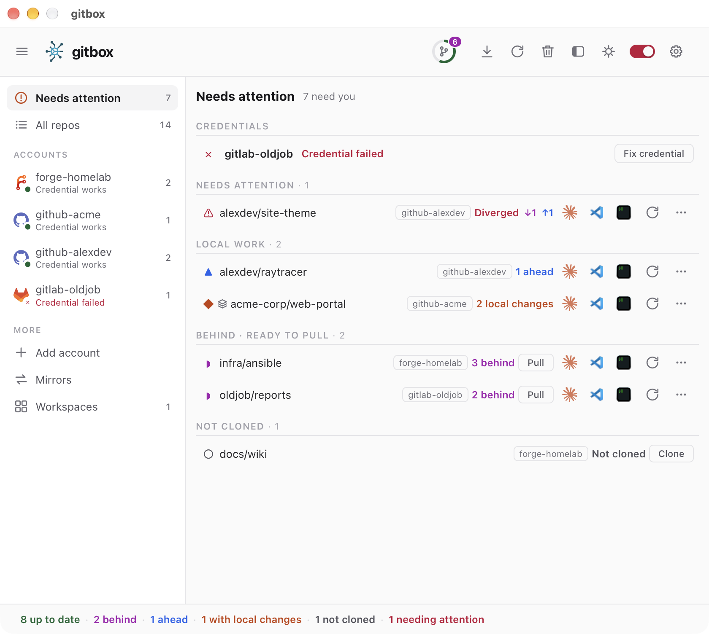
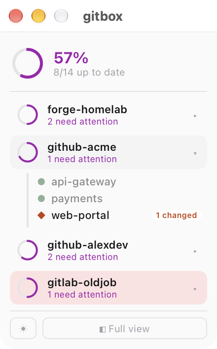
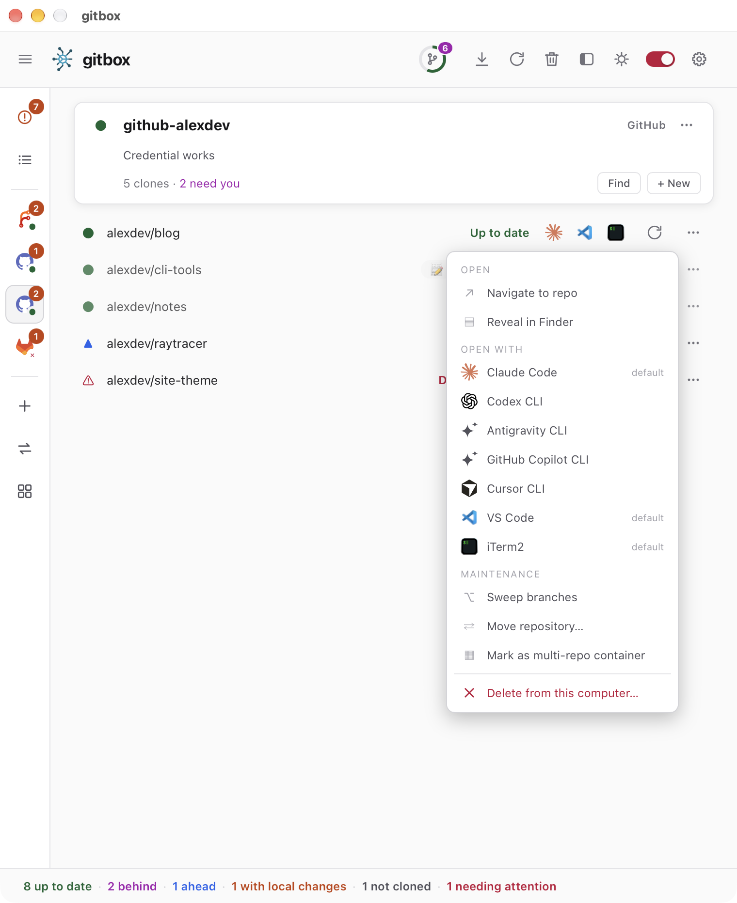

<p align="center">
  
</p>

# Gitbox desktop — user guide

Gitbox is a desktop app that keeps your Git projects organized and up to date, even when you work with several accounts on GitHub, GitLab, Gitea, Forgejo and Bitbucket.

This guide covers everything from first launch to day-to-day use.

## Install

Download the installer for your platform from the [Releases](https://github.com/LuisPalacios/gitbox/releases) page:

- **Windows** — `gitbox-win-amd64-setup.exe` installs `GitboxApp.exe` to Program Files with Start menu shortcuts.
- **macOS** — `gitbox-macos-arm64.dmg` or `gitbox-macos-amd64.dmg`, for macOS 13 Ventura or later. Open the DMG and run its install script from Terminal.
- **Linux** — `gitbox-x86_64.AppImage`, self-contained: download it and run it.

You can also download a ZIP archive (`gitbox-<platform>-<arch>.zip`) and extract it by hand. Each one holds only the app: `GitboxApp.exe`, `GitboxApp.app` or `GitboxApp`.

> **macOS:** Apple doesn't sign the app. The DMG includes an "Install Gitbox" script that copies `GitboxApp.app` to `/Applications/` and removes the quarantine flags. Run `bash "/Volumes/gitbox/Install Gitbox.command"` from Terminal. For a manual install, run `xattr -cr /path/to/GitboxApp.app`.

Gitbox calls tools that are already on the system: **Git** on your PATH, and [Git Credential Manager](https://github.com/git-ecosystem/git-credential-manager) for GCM accounts. **Settings → System check** lists anything missing with the install command for your OS. See [Settings panel](#settings-panel).

### Bootstrap script

On macOS, Linux or Windows (Git Bash), the bootstrap script downloads the latest release and installs the app:

```bash
bash <(curl -fsSL https://raw.githubusercontent.com/LuisPalacios/gitbox/main/scripts/bootstrap.sh)
```

Use `--version <tag>` for a specific release or `--prefix <dir>` to change the install directory (default `~/bin`; macOS installs `GitboxApp.app` to `/Applications/`).

On Linux the script also registers the app in the Activities menu, so you can search for "Gitbox" or drag it to the dock. Skip that with `--no-desktop`, or run it later on its own:

```bash
bash <(curl -fsSL https://raw.githubusercontent.com/LuisPalacios/gitbox/main/scripts/register-gitbox.sh)
```

Pass `--uninstall` to the same script to remove the menu entry. In-app updates and later bootstrap runs don't need a re-register.

On Windows the setup exe and the bootstrap script are alternatives: the setup exe installs into Program Files with a Start menu entry, the bootstrap script into `~/bin` with none. Pick one. When the bootstrap script finds a copy from the setup exe, it warns that the Start menu keeps launching that copy and leaves it in place. It also flags a half-removed install (an uninstall entry whose files are gone) and prints the commands to clean it up.

Headless hosts can't run the app. There, `--cli-only` installs the latest 1.x `gitbox` CLI from the v1 maintenance line. The script picks it on its own on Linux when neither `DISPLAY` nor `WAYLAND_DISPLAY` is set.

### Linux AppImage

Download the AppImage, make it executable, and run it:

```bash
chmod +x gitbox-x86_64.AppImage
./gitbox-x86_64.AppImage
```

The app needs a desktop environment with a display server (X11 or Wayland).

## Step 1: First launch

The first time you open Gitbox, a short guided setup walks you through three steps:

1. **Where do you keep your projects?** — pick your first **clone root**, the folder where your projects live on disk, such as `~/00.git` or `C:\repos`. You can add more roots later in Settings.
2. **Connect where your projects are stored** — pick GitHub, GitLab, Bitbucket, or the **Forgejo** and **Gitea** tile (then choose which one and type the server address). Type your username, your name and your email. The name and email are prefilled from your global git identity when it has one, and they appear on the changes you save. Click **Sign in with the browser** and log in. Gitbox uses Git Credential Manager (GCM) for this.
3. **Pick projects to download** — Gitbox lists the repositories your account can see. Tick the ones you want and click **Download**. They start cloning as soon as the main screen opens.

If GCM isn't installed, step 2 shows how to install it and offers **Use a token instead**, which links to the page where you create a token and asks you to paste it. If sign-in fails, you can **Try again**, switch to a token, or go back with **Change details**.

You never type an account key: Gitbox picks one for you, such as `github-alice`, which is also the account's folder name on disk. You can **Skip for now** at steps 2 and 3 and add accounts later. New installs start in [Simple mode](#simple-and-advanced-modes). If you quit after the first step, the next launch opens the main screen; finish from **Connect an account** in the sidebar.

On later launches, Gitbox shows your clones, preferences and container nesting right away, before the status checks finish. Spinners mark the clones it is still checking or fetching.

## Step 2: Add accounts

An account tells Gitbox who you are on a particular server, for example your GitHub account or your company's GitLab.

In Simple mode, **Connect an account** in the sidebar runs the same connect and pick-projects steps as the first launch. In Advanced mode, **Add account** opens the full form, which also offers SSH and lets you choose the account key. Fill in:

1. **Account key** — a short name you choose, such as `github-personal`. It also becomes the folder name on disk.
2. **Provider** — GitHub, GitLab, Gitea, Forgejo or Bitbucket.
3. **URL** — the server address. For GitHub this is `https://github.com`.
4. **Username** — your account name on that service.
5. **Name and Email** — the identity used in your Git commits.
6. **Credential type** — how Gitbox authenticates (see below).

### Setting up credentials

After you create the account, Gitbox needs a way to log in to your provider. There are three options:

- **GCM (Git Credential Manager)** — the easiest. Gitbox opens your browser so you can log in. Best for GitHub and GitLab.
- **Token (personal access token)** — you create a token on your provider's website and paste it into Gitbox. The app tells you which URL to visit and which permissions to select.
- **SSH** — Gitbox generates a key pair. You copy the public key and add it to your provider's settings; the app gives you the direct link.

Once the credential works, the account's sidebar entry and card read **Credential works** next to a green mark. For details on each type and its permissions, see [credentials.md](credentials.md).

## Step 3: Find and add projects

Select the account in the sidebar and click **Find** on its card, or pick **Find projects…** from the account's ⋯ menu. Gitbox asks your provider for every repository your account can see and lists them A to Z.

- **Search field** — type to filter the list.
- **Select all** — selects everything visible, respecting the filter.
- **Already added** — repos already in your config appear dimmed and can't be selected again.

Pick the ones you want and click **Add & Pull**. Gitbox saves them to your config and clones them into the account's clone root. With two or more roots, it first asks which one they go to.

Discovery only adds repos to your config; it never removes them.

## Day-to-day

Close any dialog with **Escape** or by clicking outside it. Dialogs that are busy or that need an explicit choice (a running clone, a confirmation in progress) stay open until they finish. Account names, repo rows and organization badges also respond to **Enter** and **Space** when you reach them with **Tab**.

### Simple and Advanced modes

Gitbox has two experiences. **Simple** is for people who don't know git and only want their projects safe. **Advanced** shows every git detail and tool. Switch with the toggle in the top bar, left of the settings gear: grey is Simple, red is Advanced, the mode with destructive power. New installs start in Simple; configs from before the setting existed stay in Advanced. The choice is saved as `global.ui_mode` in `gitbox.json`.

In Simple, every project answers one question, "is my work safe?", with one of six states:

- **Saved** — everything is on the server.
- **Work in progress · N files safe here** — files changed on this computer that aren't on the server yet. Open the project with your AI and ask it to save them.
- **Saved here, not uploaded** — saved changes that haven't reached the server. Hover for the detail.
- **Newer version online** — the server has newer work. **Update** only adds the newer version and never touches your work. Gitbox never updates on its own.
- **Only online** — the project isn't on this computer yet. **Download** gets it.
- **Needs help** — something went wrong, for example both copies changed. Click the project to see what's wrong, and open it with your AI to fix it.

Names show without the organization prefix; hover a name to see it in full. Rows keep the three [launch buttons](#clone-actions), and the ⋯ menu offers Open on the web, the folder, editors, AI harnesses and **Delete from this computer…**.

Simple hides the rest: the Mirrors view, delete mode, the compact view and theme buttons (the theme stays in Settings), container and branch badges, ahead, behind and changed counts, and the per-row fetch button. Badges for your open PRs (📝) and PRs awaiting your review (👀) show in both modes. The top bar keeps **Check all** and **Update all**. Account health reads in plain words, and **Reconnect** appears when a credential breaks. Settings hides the Config, PR / reviews, Global gitignore and Terminals rows. The compact view is the same in both modes.

### Full view

The full view shows the top bar, the sidebar, the selected view and the summary footer. The top bar holds the health rings and the Pull all, Fetch all, Delete mode, Compact view, theme, Simple/Advanced and Settings buttons; the GitBox logo at the far left folds the sidebar. The summary footer always shows both repo and mirror counts.

The repo ring holds a branch icon and fills as clones get up to date (in Simple, as projects are saved). A small badge counts what isn't there yet, and hovering the ring shows the full `N of total up to date` (Simple: `N of total saved`) line. When the ring has something pending, clicking it opens **Needs attention** (Simple: **Needs you**). Advanced adds a [mirror ring](#mirror-health-ring) when mirrors are configured.

The window opens 1040 px wide the first time and can shrink to 640 × 480. It grows no wider than the sidebar plus 1100 px of content, and folding the sidebar gives its width to the content.

### The sidebar

The sidebar on the left picks what the main area shows:

- **Needs attention** (Simple: **Needs you**) — first the accounts whose credential needs a fix, each with its fix button, then every repo that needs you, grouped as needs help, local work, behind, and not cloned. Inside each group, rows sit under a header per account, in alphabetical order. A container nests the clones beside it, as in All repos; a clone whose container is in another group shows an "in \<parent\>" tag. A row that turns fine while you watch, after a pull for example, stays in place, faded, until you leave the view. When nothing needs you, the view says so.
- **All repos** (Simple: **All projects**) — every clone, grouped by account, in alphabetical order.
- **Accounts** — one entry per account with its provider logo, a small health mark, its name, its health in words, and how many repos need you. Click one to open the account's view.
- **More** — below the bottom separator, everything that isn't an account:
  - **Add account** (Simple: **Connect an account**) — see [Step 2](#step-2-add-accounts).
  - **Found on disk** — appears when Gitbox finds clones on disk it couldn't place on its own, with how many, or when you ignored some. It opens **Unmatched clones** (see [Clones found on disk](#clones-found-on-disk)).
  - **Mirrors**, in Advanced only.

The GitBox logo at the top left, or ⌘B on macOS and Ctrl+B elsewhere, folds the sidebar to an icon rail. The rail keeps the provider logos with their health mark and attention count; hovering one shows the account name and its health, and one click switches to it. In a window narrower than 780 px the sidebar always shows as the rail, and the logo opens the full sidebar over the content until you pick a view.

Gitbox remembers the last view and the folded sidebar across restarts. If that account no longer exists, or Simple can't show Mirrors, Needs attention opens instead. Renaming an account keeps its view.

### Understanding the account card

An account's view starts with a three-line card:

1. **Health mark and name** on the left; click the name to edit the account. The provider and the account ⋯ menu sit on the right.
2. **Health in words**: Credential works, Works, with a warning, Offline · can't reach the server, Credential failed, or No credential set up (Simple: Connected, Can't connect right now, Needs reconnecting, Not connected). When something needs fixing, the button on the right does it: **Retry** checks an offline account again, and **Fix credential**, **Set up credential** or Simple's **Reconnect** opens the credential screen. In Advanced, hovering the words shows the credential type and its messages.
3. **Counts**: how many repos the account holds and how many need you. **Find** discovers repos and **+ New** creates one, in both modes. Both are disabled, with the reason on hover, when the credential can't reach the provider API.

When a working GitHub or GitLab token expires within 14 days, the health words change to **Token expires in N days** in orange, and **Replace token** (Simple: **Renew**) opens the credential screen. The sidebar entry and its tooltip say the same. In Advanced, hovering the words also shows the expiry date of any token that has one. Gitea, Forgejo and Bitbucket APIs don't report token expiry, so those accounts never show this warning.

A missing or broken credential tints the card light red, and a warning tints it orange. The account's clones follow the card, in alphabetical order. A clone nested in another account's container shows here with an "in \<parent\>" tag; **All repos** keeps it under its container, while its actions still use its own account.

### Collapse and expand

The **All repos** view folds at two levels, and an account's view folds parent clones too:

- **Account groups** — each account sits in its own light card, here and in **Needs attention**. Its name, in uppercase and in its provider's colour (GitHub indigo, GitLab orange, Gitea green, Forgejo red, Bitbucket blue), sits in the column of the status dots below, next to the filled ▾ caret that hangs to its left. Click the header bar or the name to fold its clone list. The header always shows how many clones it holds and how many need attention, folded or not, so a problem never hides behind a fold. The ⋯ menu on the header keeps working and never folds the group.
- **Clones with clones below them** — a clone that has nested clones or not-yet-cloned workspace folders under it shows an outlined ▾ chevron in place of its status dot, so its name stays in line with its siblings'; its status words still say how it is. Click the chevron or the clone's name to fold everything below, at any depth. A folded row shows how many rows it hides and how many of them need attention. Neither opens the repo detail.

Gitbox remembers what you fold across restarts (`global.collapsed` in `gitbox.json`) and forgets entries for accounts or clones you delete or rename. The compact view keeps its own per-account expansion.

### Keeping projects in sync

#### Automatic checking

Gitbox watches your projects and shows their status:

- **Up to date** (green) — matches the remote.
- **N behind** (magenta) — the remote has N new commits you can pull.
- **N local changes · protected** (orange) — you have uncommitted work, and nothing in Gitbox touches it.
- **N ahead** (blue) — you have N commits that haven't been pushed.
- **Diverged**, **Conflict**, **Upstream gone** and **Error** (red) — the repo needs a look; click it for the details.
- **Not cloned** (grey) — the repo isn't on this computer yet; **Clone** downloads it.
- **Root offline** (grey; Simple: **Folder not found**) — its clone root isn't there, for example an unplugged drive. Nothing is lost: the repo comes back when the root does.
- **Local branch** (green) — on a feature branch with no upstream tracking, which is normal.
- **No upstream** (grey) — the default branch has no upstream tracking and needs attention.

Clones always appear in alphabetical order of the name the row shows, nested clones too. When some row in a list needs you, the rows with nothing to do fade slightly until you hover them, so the problems stand out.

A repo checked out on a non-default branch shows a small branch badge next to its name, such as `feature-xyz`. A detached HEAD shows a red `detached` badge.

#### Pull all

Click **Pull all** (down-arrow icon) in the top bar to bring everything up to date. It clones missing repos and pulls repos that are behind with fast-forward only (`git pull --ff-only`), so it never merges and never touches local changes. A behind row's own **Pull · FF only** button does the same for one repo. In Simple, the button is **Update all**.

#### Fetch all

Click **Fetch all** (↻ icon) to check every remote for new commits without pulling. The status indicators update so you can see what changed before you pull. In Simple, the button is **Check all**.

#### Activity and result cards

While Fetch all or Pull all runs, a strip under the top bar says what it covers, such as "Fetching 17 clones across 3 accounts" or "Pulling 2 (fast-forward only) and cloning 1", with a progress bar. When it ends, a result card in the bottom-right corner sums it up: how many clones it fetched, how many are now behind and ready to pull, which ones it skipped because their account is offline, any failures with the first error, and that local changes were left untouched. Success cards go away after a few seconds; a card with a failure stays until you close it. Startup and periodic fetches leave a card only when something changed or failed.

Other actions report their errors the same way, for example a tool that doesn't open or a mirror that can't be added.

#### Periodic fetch

**Settings → Periodic status check** (Simple: **Check for changes**) fetches every remote every 5, 15 or 30 minutes and re-checks credential health in the background.

Startup, periodic and manual checks share one refresh cycle. Local status shows as soon as the Git checks finish; the fetch indicator stays on until the credential and provider checks finish too. A slow or unreachable provider never turns a known clone into a missing upstream. If Gitbox can't restore a clone's configured identity, origin or credential isolation, it shows a warning and skips that clone's fetch.

#### Viewing details

Click a repo that shows local changes, conflicts or other issues. A panel opens with:

- The current branch and how many commits you're ahead or behind.
- Every changed file, with an icon for what happened (added, deleted, renamed, modified).
- Any untracked files.

The panel updates on its own when Gitbox detects new changes.

### Compact view

Click **◧** in the top bar to switch to compact mode, a narrow status strip about 220 px wide:

- **Global health ring** — overall sync percentage and count.
- **Account pills** — one per account with a mini ring and issue count. Click one to see its repos.
- **Mirror pill** — when mirrors are configured, the active/total count with a coloured dot.
- **Theme toggle** and a **◧ Full view** button at the bottom.

Keep Gitbox visible beside other apps this way. Compact mode shows status only: switch back to the full view to reach the clone and account actions.

<p align="center">
  
</p>

### Clones found on disk

Gitbox keeps `gitbox.json` in step with the clones under your clone roots. It checks at startup, when the window regains focus, after a manual **Fetch all**, and when the roots change:

- **New clones it recognises** are added on their own, in place; Gitbox never moves them. A clone counts as recognised when exactly one account matches it and something beyond the server confirms it: the owner is the account's username, it sits under that account's folder in a root, or its remote URL or `credential.<url>.username` names the account.
- **Moved clones** — when a tracked repo's folder is gone but a clone of the same repo shows up elsewhere under a root, Gitbox points the entry at the new place instead of listing it twice.
- **Deleted clones** stay listed as **Not cloned**, so you can clone them again or delete the entry.
- **Repos under a missing root** read **Root offline** and are left alone until the root comes back.

For each added clone, Gitbox configures per-repo credential isolation, sets `user.name` and `user.email` from the account, and rewrites the remote URL to match the credential type.

Everything else waits in **Unmatched clones**, opened from **Found on disk** in the sidebar. Each row says why Gitbox couldn't place it:

- **matches the server only** — one account on that server, but nothing else ties the clone to it, as with someone else's project cloned to read.
- **several accounts match** — two or more accounts on the same server tie.
- **no account on this server**
- **no remote** — no `origin`.
- **already tracked at another path** — a second checkout of a repo Gitbox already tracks.
- **a git worktree of another clone**

Where an account can apply, pick it and click **Adopt**; the clone joins that account in place. **Ignore** hides a clone for good, and **Show ignored** lists the ignored ones, where you can still **Adopt** one or **Stop ignoring** it. Ignored paths are saved in `global.ignored_clones`. The scoring rules behind the account match are in [Architecture › pkg/adopt](architecture.md#pkgadopt--orphan-repo-discovery).

## Repo and account actions

### Clone actions

Each cloned repo row has three launch buttons, in both modes: your first AI harness, your first editor and your default terminal profile. Each shows the tool's logo when Gitbox knows it (Claude, Codex, Gemini, Cursor, VS Code, Zed and every terminal app Gitbox detects) or a generic icon, and its name on hover.

Next to them, the **⋯ menu** is one flat list in sections, with no submenus:

1. **Open** — **Navigate to repo** opens the repo on the provider, and **Reveal in Finder** (Explorer, or the file manager on Linux) opens its folder.
2. **Open with** — every AI harness and editor, then the default terminal profile and the ones marked Preferred, each with its logo. The tool the row's own launch button uses carries a **default** tag.
3. **Maintenance** (Advanced) — **Sweep branches**, **Move repository…**, **Mark as multi-repo container** or **Unmark as multi-repo container**, **Choose workspace…** on a container with workspace files, and **Re-scan for nested clones**.
4. **Delete from this computer…** — in both modes.

<p align="center">
  
</p>

The default editor and AI harness are the first entries of `global.editors` and `global.ai_harnesses` in `gitbox.json`; reorder those arrays to change them, and the menu follows the config order. The default terminal is the profile marked Default in **Settings → Terminals → Manager** (see [Editors and terminal profiles](#editors-and-terminal-profiles)).

When the clone hasn't finished or its status hasn't loaded yet, the folder, editor, terminal and AI harness entries say to clone first instead of doing nothing.

**🧹 Sweep branches** finds and deletes stale local branches. A confirmation dialog lists them before anything is deleted, and the current branch and the default branch are never touched. It detects three kinds:

- **Gone** — the remote tracking branch was deleted, for example after a PR merged and its branch was deleted on the server. Deleted with `git branch -D`.
- **Merged** — fully merged into the default branch. Deleted with `git branch -d`.
- **Squashed** — squash-merged or rebase-merged on the server (different commits, same changes). Deleted with `git branch -D`.

### Account actions

Each account has a **⋯ menu**: on its card in the account's view, and on its group header in **All repos**. It uses the same sections as the repo menu, scoped to the account's folder (`<root>/<account-key>`, in the account's clone root) instead of a single clone:

- **Navigate to account** — opens the account's profile or group page on the provider, such as `https://github.com/<username>`.
- **Reveal in Finder** (Explorer, or the file manager) — opens the account's folder, handy for cross-repo searches and multi-repo edits.
- **Open with** — the same AI harness, editor and terminal entries as the repo menu, opened in the account's folder. There is no Sweep branches here.
- **Account** — **Find projects…** and **Create repo…**, disabled when the credential can't reach the provider API; **Edit account…**; and **Change credential…** in Advanced, or **Reconnect…** in Simple when the credential is broken.

The account folder exists only once something is cloned under the account. Until then, the folder and editor entries do nothing and the terminal and AI harness entries show "account folder does not exist", so clone at least one repo first.

### Editors and terminal profiles

Gitbox detects VS Code and Zed on your PATH at startup and writes them to `global.editors` with their full paths. Add any other editor by hand with its `name` and `command`. Cursor and other agentic IDEs show among the [AI harnesses](#ai-harness-actions), not the editors.

Terminals use profiles. At startup Gitbox detects the installed terminal apps and shells, writes them to `global.terminal_apps` and `global.shells`, and pairs them into launchable profiles in `global.terminal_profiles`:

- **Windows** — terminals: Windows Terminal, WezTerm, Alacritty, Tabby, ConEmu, Hyper, Mintty and ZOC. Shells: PowerShell 7 and 5, Command Prompt, Git Bash and WSL. A profile pairs a terminal with a shell, for example `Windows Terminal — PowerShell 7`.
- **macOS** — iTerm2, Terminal, Warp, Kitty, Ghostty, WezTerm and Alacritty. A profile is the terminal alone and runs your login shell (Zsh, Bash, Fish or Dash).
- **Linux** — GNOME Terminal, Konsole, Terminator, Foot, Alacritty, Kitty, Tilda, Guake and xterm. A profile is the terminal alone and runs your login shell (Bash, Zsh, Fish, Ksh or Dash).

**Settings → Terminals → Manager** opens the profile editor in its own window, which closes with the main window. It lists the detected terminal apps and shells (read-only) and the profiles. Per profile, you can:

- Mark it **Default** (the row's terminal button and the menu's **default** tag), **Preferred** (listed under **Open with**) or **Hidden**.
- Edit its name, terminal and shell, add your own profiles, or delete the ones you added.
- Click **Re-detect** to pick up new shells, terminals or WezTerm `launch_menu` entries without restarting.

Re-detection keeps your flags, renames, hand-edited args and added profiles. To pass extra flags to a profile, edit its `args` in `gitbox.json`.

On Windows, bare-shell profiles that open a shell without a terminal app (`pwsh.exe`, `powershell.exe`, `cmd.exe`, `wsl.exe`) are hidden by default and only show up on their own when no modern terminal is installed. Un-hide one in the Manager for a direct shortcut.

#### Windows Terminal and WezTerm profiles

These two terminals launch through your own terminal config when they can, so the shell opens with the font, colours and startup settings you tuned there.

- **Windows Terminal** — a profile matches the WT profile with the same shell name, such as `PowerShell 7`, or the one for that WSL distro. It opens as a new tab in your most recent WT window. Hidden WT profiles and those from a disabled profile source never match. Gitbox reads `settings.json` from the Store install (`%LOCALAPPDATA%\Packages\Microsoft.WindowsTerminal_8wekyb3d8bbwe\LocalState\`), then Preview, then the unpackaged install (`%LOCALAPPDATA%\Microsoft\Windows Terminal\`), and picks up edits on the next launch.
- **WezTerm** — on every OS, each entry of `config.launch_menu` in `wezterm.lua` becomes a profile, and launching it runs that entry's own `args`. Lua picker callbacks (per-entry `color_scheme`, `mux.spawn_window` hooks) don't run, because they only fire when you pick the entry from WezTerm's own launcher.

Without a match, Gitbox uses the terminal's generic launch arguments. The matching rules are in [Architecture › How launch matching works](architecture.md#how-launch-matching-works).

### AI harness actions

AI CLI harnesses (Claude Code, Codex, Antigravity, Aider, Cursor Agent, OpenCode, …) are interactive programs that need a terminal. Each one Gitbox finds appears under **Open with** in the repo and account ⋯ menus, and the first is the row's AI launch button.

Clicking one opens the **default terminal profile** in the folder and runs the harness inside that profile's shell. Your shell's startup files and PATH apply (`nvm` and `npm` on macOS and Linux, Git Bash on Windows), and you land at an interactive prompt when the harness exits. Matched Windows Terminal and WezTerm profiles keep their font and colours. To change the host, mark a different profile Default in **Settings → Terminals → Manager**.

On macOS, Terminal and iTerm2 run the harness through AppleScript, so the first run may ask for Automation permission. Warp, Kitty, Ghostty and Alacritty on macOS can't run a command at launch: with one of them as the default profile, a harness entry shows an error naming the profile. Mark iTerm2, Terminal or WezTerm as Default instead.

Gitbox looks for harnesses in the background shortly after the window opens, every ten minutes and when the window regains focus, so a newly installed tool shows up without a restart. Besides PATH, it looks in `~/.local/bin`, the Homebrew prefixes on macOS, and per-tool install folders such as `%LOCALAPPDATA%\agy\bin` for Antigravity on Windows. Found harnesses go to `global.ai_harnesses`, each with a `name`, a `command` and an optional `args` array for harness flags, such as `["--model", "sonnet-4.6"]`.

When you uninstall a harness, it disappears from the menu but stays in the config, so reinstalling it, even somewhere else on disk, brings it back with your `args`. Entries you add by hand hide the same way when their `command` stops resolving, but Gitbox never rewrites them. The list of tools Gitbox looks for is described in [Agentic tools directory](agentic-tools-directory.md).

### Creating repositories

Click **+ New** on the account card, or pick **Create repo…** from the account's ⋯ menu, to create a repository on the provider without leaving Gitbox. The dialog asks for:

- **Owner** — your personal username plus the organizations the provider API reports.
- **Name** — only `a-z`, `A-Z`, `0-9`, `.`, `_` and `-` are allowed. Other characters are stripped, and spaces turn into hyphens as you type.
- **Description** — an optional one-line summary.
- **Private** — checked by default. Uncheck it for a public repo.
- **Clone after creating** — checked by default. Gitbox then adds the repo to your config and clones it right away, and the button reads **Create & Clone** instead of **Create**.
- **Clone root** — shown when you have two or more clone roots and the clone box is checked. It defaults to the account's root.

Creation works on every provider and credential type, with the same API token discovery uses.

### Editing an account

Click the account name on its card, or pick **Edit account…** from the account's ⋯ menu. You can change:

- **Account key** — on a rename, Gitbox renames the folder on disk, updates your SSH keys and config, migrates stored tokens and fixes every internal reference.
- **Provider** — in case you picked the wrong one.
- **All other fields** — URL, username, name, email, default branch.

### Managing credentials

Pick **Change credential…** from the account's ⋯ menu to open the credential screen. When the credential needs a fix, the button on the account card and in Needs attention opens the same screen; in Simple, the menu offers **Reconnect…** instead, and only when the credential is broken. For each credential type and its permissions, see [credentials.md](credentials.md).

#### Changing credential type

Pick GCM, Token or SSH in the dropdown and click **Setup**. Gitbox removes the old credential and its artifacts, sets up the new one, and reconfigures every existing clone.

#### Deleting a credential

While viewing the current credential type, click the red **Delete** button to remove all stored authentication data, for example to start clean after a token expired. The card then turns red and reads **No credential set up**; click **Set up credential** to start again.

### Move a repository across accounts / providers

Open the ⋯ menu on a repo row and pick **Move repository…** under **Maintenance**. The entry is disabled, with the reason on hover, unless the clone is clean and in sync. The dialog has three stages:

1. **Form** — pick the destination account and owner (personal or an organization), confirm the new repo name, set the visibility, and optionally delete the source repo and the local clone after a successful move. Both delete options start unchecked.
2. **Confirm** — a red-bordered summary lists every destructive side effect. Type the source repo key, such as `acme/widget`, to unlock **Move**.
3. **Progress** — each phase (preflight → fetch → create destination → push mirror → rewire origin → optional deletes → update config) shows as its own line with a live status.

The move keeps every ref and tag (`git push --mirror`), points `origin` on the local clone at the new URL, and moves the repo to the destination account in your config. If deleting the source repo or the local clone fails, you get a warning; the move itself is already done.

Both sides need the token scopes listed in [Token scopes by capability](credentials.md#token-scopes-by-capability).

### Deleting repos and accounts

Click the **trash icon** in the top bar to enter delete mode. Red ✕ buttons appear on the account card in an account's view, on mirror group cards and on repo rows; click one to remove that item. Deleting an account also removes its local clone folders. Click the trash icon again to leave delete mode.

## Mirrors

Mirrors keep backup copies of repos on another provider, for example pushing from a homelab Forgejo to GitHub. The providers mirror the repos server-side through their APIs; nothing is cloned locally. Mirrors are optional and available in Advanced.

### The Mirrors view

**Mirrors** under **More** in the sidebar opens the view: a header with the **Discover** and **Check all** buttons, the mirror group cards, and the mirror detail list underneath.

### Mirror cards

Each mirror group shows as a chip (status dot and account pair) that opens into a card; click outside it or press **Escape** to fold it back. The card shows:

- **Status dot** — green when every repo is active, red when there are errors, amber otherwise.
- **MIRROR label** with the group's `active/total` mirrors, coloured like the dot.
- **Account pair**, such as `forgejo ↔ github`.
- **Check** — verifies the sync state by comparing the HEAD commits on both sides.

A **+** chip after the cards creates a new mirror group.

### Mirror health ring

When mirrors are configured, the top bar shows a second ring with a two-arrow icon next to the repo ring. It fills as mirrors turn active and turns red if any mirror has errors. Its badge counts the mirrors that aren't active, hovering it shows the `active/total` line, and clicking it opens **Mirrors**.

### Mirror actions

- **Discover** — scans every account pair for existing mirrors, with decreasing confidence: push mirror API (confirmed), pull mirror flag (likely) and name match (possible). A progress bar shows each account's progress. Repos already in your config are marked **configured** and dimmed. Add the others one by one with **+ Add**, or all at once with **Apply to config**.
- **Check all** — checks the sync status of every mirror group.

### Mirror detail list

Below the cards, each group lists its mirrored repos with:

- The direction, such as `origin → backup (mirror)`.
- The sync status, such as Synced OK or Backup is behind origin.
- A warning icon when the backup repo is public.
- **Setup** for repos not yet configured through the API.
- **+ Repo** to add repos to the group.

## VS Code workspaces and multi-repo containers

A **multi-repo container** is a clone that holds other clones in its working tree, for example a project repo whose `.code-workspace` ties together several sibling clones. Workspaces live in the clone list, on the container that holds them; there is no separate workspaces view. Gitbox never creates, edits or deletes `.code-workspace` files: they're yours.

### Workspace files make containers

A clone with a `.code-workspace` file at its root becomes a container on its own, and Gitbox records that file in `repo.workspace`. When the root holds two or more, Gitbox asks which one the container opens with. Until you choose, the row shows a **choose workspace** hint, and **Choose workspace…** in the ⋯ menu changes it later. Gitbox remembers your pick in `repo.workspace_preferred`: if that file disappears, another file at the root stands in, and when it comes back the container opens it again without asking. A 📁 icon marks a container, and hovering it names its workspace file.

Gitbox checks at startup, on window focus, after a manual Fetch all and after you change the clone roots, so a new workspace file turns its clone into a container the next time you switch back to Gitbox. If the file disappears, Gitbox clears `repo.workspace` and keeps the container.

### Clones below a container

Every clone inside a container's working tree shows below it, indented, and folds with it. Gitbox looks for them down to the **nested scan depth** below the container, and in every folder the container's workspace file lists, at any depth. Nested clones join their real account and organization in place, stored with an absolute `clone_folder` inside the container, and never move. A folder the workspace file lists inside the container that isn't on disk yet shows as a dimmed **not cloned** row with its path, unless it sits inside another clone, like a submodule that isn't checked out. Folders the workspace lists outside the container keep their normal place under their own account.

A container with a workspace file, the clones that file lists and its not-cloned folders show their names in blue, so you see at a glance what VS Code opens. A nested clone the workspace doesn't list keeps the normal colour.

### Opening a container

On a container with a workspace file, the editor button opens the `.code-workspace` file instead of the folder when the editor is VS Code or a fork of it (VS Code Insiders, VSCodium, Cursor, Windsurf). Other editors open the folder. The editors in the ⋯ menu behave the same way.

### Containers without a workspace file

You can flag a clone without a workspace file from the repo row's ⋯ menu, under **Maintenance**: **Mark as multi-repo container**, **Unmark as multi-repo container**, and **Re-scan for nested clones** once it is a container. A container with a workspace file has no Unmark entry, because the file is what makes it one. The **Clone roots** dialog in Settings sets the **nested scan depth**: how many levels below a container Gitbox looks, default 1 (the container's immediate children).

The standard layout is `<root>/<account>/<org|user>/<repo>`. A clone found at that spot under any clone root is adopted in place under that root. A clone found elsewhere in a root is added where it is too, with an absolute `clone_folder`. Gitbox never moves a clone.

## Settings and maintenance

### Settings panel

Click the **gear icon** to open the settings panel:

- **Config** — the path to your config file, with an **Open in Editor** button.
- **Clone roots** — the folders where projects live, the default first, with a **Change** button (see [Clone roots](#clone-roots)).
- **Language** — English or Español. The change applies at once.
- **Theme** — System, Light or Dark.
- **Periodic status check** (Simple: **Check for changes**) — the automatic fetch interval: Off, 5m, 15m or 30m.
- **Run at startup** — launch Gitbox when you log in, where the platform supports it.
- **PR / reviews** — show badges for your open PRs and the PRs awaiting your review, with **Include drafts** to count draft PRs.
- **Global gitignore** — the automatic startup check of `~/.gitignore_global` (see [Global gitignore warning](#global-gitignore-warning)).
- **System check** — **Run** opens a report of every external tool Gitbox uses (`git`, `git-credential-manager`, `ssh`, `ssh-keygen`, `ssh-add`, and `wsl` on Windows): where it's installed, its version, and an install command for anything missing that your config needs. Each tool reads ok, missing (required by your config) or optional.
- **Terminals** — **Manager** opens the terminal profile editor (see [Editors and terminal profiles](#editors-and-terminal-profiles)).
- **Version** — the current app version.
- **Author** — the project author and a link to the GitHub repository.

The add-account and change-credential flows run the same tool check: if you pick the `gcm` credential type on a machine without Git Credential Manager, a yellow banner shows the install command instead of a cryptic authentication failure later on.

### Clone roots

Gitbox keeps clones under one or more **clone roots**, for example `~/00.git` for everyday work and a bigger disk for large projects. Each clone lives at `<root>/<account>/<org|user>/<repo>`. The first root is the default, and new accounts clone into it.

Open **Settings**, then **Change** next to **Clone roots**, to manage them. Each row shows the folder, how many repos live under it, and a **Default** badge on the default one. A root that isn't on disk shows struck through.

- **+ Add root…** — pick a folder; Gitbox creates it if it doesn't exist.
- **Make default** — new accounts clone into this root from now on. Accounts that already use the old default stay on it, and no clone moves.
- **✕** — removes a root. When repos still live under it, Gitbox asks whether to forget them; their files stay on disk.

With two or more roots, an explicit clone asks once where it goes: a row's **Clone** (Simple: **Download**), **Find → Add & Pull**, and the projects you pick when you add an account. The choice defaults to the account's root, and the account remembers it for its next clone. **Create repository** shows the same choice as a field. **Pull all** never asks: missing clones go to their account's root.

The same dialog sets the **nested scan depth** for [multi-repo containers](#containers-without-a-workspace-file).

### Update notification

Gitbox checks for updates at launch and every six hours while it runs. When a newer version is available, an amber pill appears on the right of the footer with the new version. Click it to download and apply the update in place. Gitbox verifies the release signature and checksum and refuses an update that fails either check; see [Release signing](release-signing.md). It replaces only what is already installed next to the app (on macOS, the whole `GitboxApp.app` bundle) and restarts on the new version. If the new version can't start on its own, the pill says so: click **Quit** and start the app again. The pill shows on every launch until you update; the ✕ hides it until the next launch.

The Linux AppImage only notifies: clicking the pill opens the release page, and you download the new AppImage and replace the old file yourself.

The updater follows the release GitHub marks as latest, so a v1 GUI moves to v2 the same way.

### Global identity warning

If your `~/.gitconfig` has a global `user.name` or `user.email`, an **orange banner** appears at the top of the dashboard, because a global identity can override the per-repo identities Gitbox sets for each account. Click **Remove** to clear those entries, or dismiss the banner with **✕**.

### Global credential helper warning

When at least one account uses GCM, Gitbox checks that your global `~/.gitconfig` has a `credential.helper` that resolves to Git Credential Manager (`manager`, the legacy `manager-core`, or an absolute path to the `git-credential-manager` binary) and `credential.credentialStore` set for your OS (`keychain` on macOS, `wincredman` on Windows, `secretservice` on Linux). If not, a second orange banner names the problem. Without a GCM helper, sign-in falls through to a terminal prompt and fails in the app with `fatal: could not read Password ... Device not configured`.

Click **Configure** to fix both entries in one step. Gitbox also saves the same defaults in `gitbox.json`, so the check keeps passing even if `~/.gitconfig` is edited later. Dismiss the banner with **✕** to handle it by hand.

### Global gitignore warning

Gitbox shows a banner when `~/.gitignore_global` is missing, its recommended block is out of date, managed patterns are duplicated outside the block, or `core.excludesfile` is unset. **Install** writes a curated block of OS-junk patterns (`.DS_Store`, `Thumbs.db`, `*~`, …), points `core.excludesfile` at it, and saves a timestamped `.bak-YYYYMMDD-HHMMSS` copy of any existing file, keeping the last three. Patterns and comments you add outside the managed block survive every reinstall.

**Settings → Global gitignore** turns the automatic startup check on or off (`global.check_global_gitignore`). The **Install** button always works, whatever the setting. The managed-block format is in [Architecture › pkg/gitignore](architecture.md#pkggitignore--global-gitignore-self-heal).

## Tips

- **Window position** — Gitbox remembers its window size and position. If the window would open off-screen, for example after you unplug a monitor, it centers on your main display.
- **External edits** — when you edit `gitbox.json` by hand, the app picks up the changes when its window regains focus.
- **Same config as v1** — the app reads `~/.config/gitbox/gitbox.json`, the same file v1 used. Older config versions migrate to version 5 on load, and the next save writes the new format.
- **Automatic backups** — every meaningful save leaves a dated copy such as `gitbox-20260401-143025.json` next to the config, and the recovery screen restores any of them in one click. See [Config format](architecture.md#4-config-format-v5).

## See also

- [Credentials](credentials.md) — credential types, permissions and troubleshooting
- [Config file reference](architecture.md#4-config-format-v5) — every `gitbox.json` key
- [Architecture](architecture.md) — technical design
