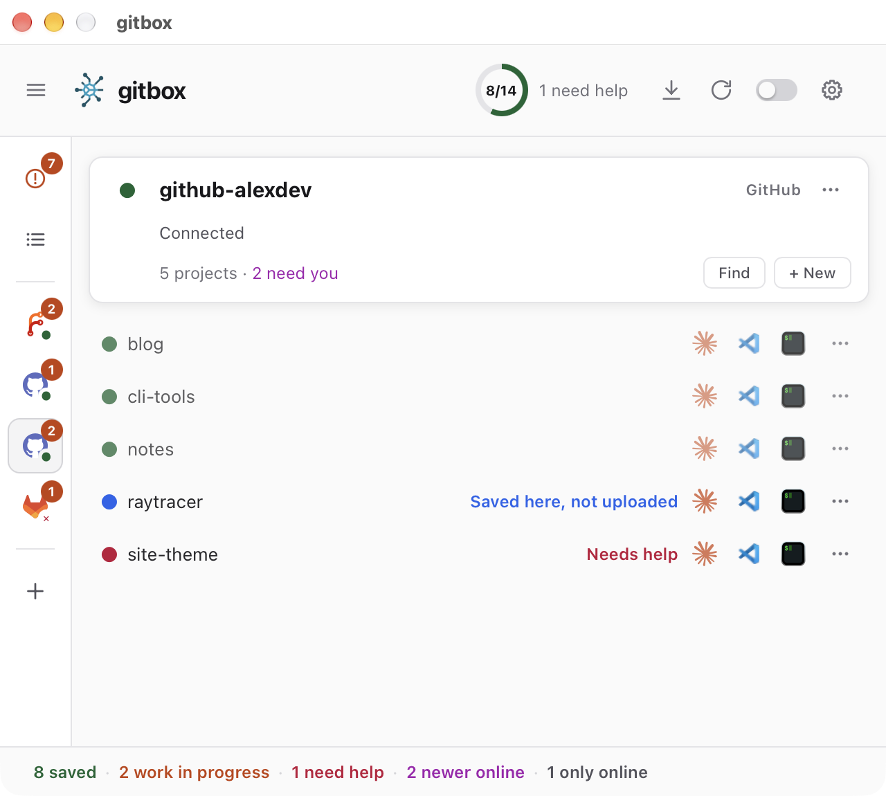
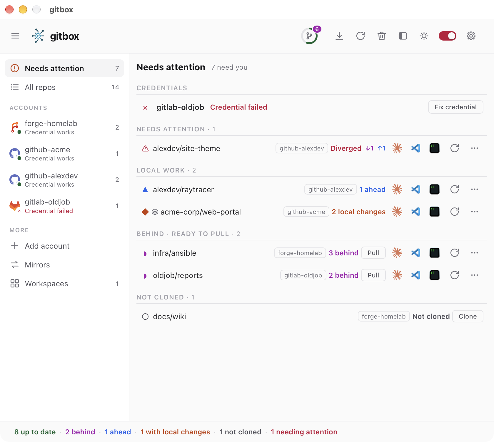

<p align="center">
  
</p>

<h1 align="center">Gitbox</h1>

<p align="center">
  <strong>One desktop app for every Git account you own.</strong><br>
  <em>Accounts and clones, nothing else. Gitbox never commits, pushes, or touches your working trees.</em>
</p>

<p align="center">
  <a href="https://github.com/LuisPalacios/gitbox/actions/workflows/ci.yml"></a>
  <a href="https://github.com/LuisPalacios/gitbox/releases/latest"></a>
  <a href="LICENSE"></a>
</p>

<p align="center">
  
</p>

## What it is

Working across several Git accounts, such as a personal GitHub, a work GitHub and a self-hosted Forgejo, tends to end in tangled credentials, commits under the wrong identity and re-cloning by hand on every new machine.

Gitbox handles that setup. You add each account once, with its own credential (GCM, SSH or token). Gitbox discovers your repos through the provider APIs, clones each one with the right identity into a predictable folder tree, and shows the state of every clone in one place.

It runs on Windows, macOS and Linux, and works with GitHub, GitLab, Gitea, Forgejo and Bitbucket. Gitbox doesn't reimplement Git: it drives the `git`, `ssh` and Git Credential Manager already on your system.

## Install

Download the installer for your platform from the [latest release](https://github.com/LuisPalacios/gitbox/releases/latest):

| Platform | Download                                            | How to install                                                                                        |
| -------- | --------------------------------------------------- | ----------------------------------------------------------------------------------------------------- |
| Windows  | `gitbox-win-amd64-setup.exe`                        | Run it. Installs `GitboxApp.exe` to Program Files with Start Menu shortcuts                           |
| macOS    | `gitbox-macos-arm64.dmg` / `gitbox-macos-amd64.dmg` | macOS 13 or later. Open the DMG and run `bash "/Volumes/gitbox/Install Gitbox.command"` from Terminal |
| Linux    | `gitbox-x86_64.AppImage`                            | `chmod +x` and run it. Self-contained, bundles GTK 3 and WebKitGTK                                    |

To install from a terminal instead, the bootstrap script downloads the latest release and installs it in one step on macOS, Linux or Windows (Git Bash). On Linux it also adds Gitbox to the applications menu:

```bash
bash <(curl -fsSL https://raw.githubusercontent.com/LuisPalacios/gitbox/main/scripts/bootstrap.sh)
```

Run it with `--help` for options. To place the app yourself, each release also ships plain zips (`gitbox-<platform>-<arch>.zip`) and a `checksums.sha256` file.

> [!WARNING]
> **The binaries are not code-signed or notarized**, so macOS Gatekeeper and Windows SmartScreen flag them. The DMG installer and the bootstrap script clear those flags for you (`xattr -cr` on macOS, `Unblock-File` on Windows). From a zip, run `xattr -cr GitboxApp.app` on macOS, or pick **More info → Run anyway** in SmartScreen. Either way you're trusting unsigned code, so audit the [source](https://github.com/LuisPalacios/gitbox) and the [bootstrap script](scripts/bootstrap.sh) first, or build it yourself.

## Features

- **Accounts and credentials**: one isolated identity per account with GCM, SSH or token auth. Changing an account's credential type reconfigures its clones.
- **Discover and clone**: find every repo through the provider API and clone it with the account's identity in its own `.git/config`.
- **Needs attention**: one sidebar entry per account with its health, and a view that lists only the accounts and clones that need action.
- **Pull requests**: open pull requests you authored and reviews waiting on you show on each row.
- **Safe sync**: fetch everything and pull fast-forward only. Gitbox never touches dirty or conflicted clones.
- **Mirrors**: push or pull mirrors between providers, for backups.
- **Moves**: move a repo to another account or provider with a guided flow.
- **Launchers**: open any clone in your terminal, editor, file manager or AI harness (Claude Code, Codex, …). A multi-repo container opens its VS Code workspace.
- **Clones anywhere**: several clone roots, and adoption of clones outside the standard folder tree, including repos nested in a container.
- **Self-healing setup**: a system check for required tools, one-click fixes for global Git settings that break per-account identity, and dated config backups you can restore.

Discovery, cloning and repo creation work on all five providers. Mirroring is automated on Gitea, Forgejo and GitLab; for GitHub and Bitbucket, Gitbox shows the manual steps.

## Simple and Advanced modes

Gitbox has two modes; switch between them with the toggle in the top bar. New installs start in Simple.

- **Simple** is for people who don't know Git and only want their projects safe. Each project says in plain words whether the work is saved, and the screen keeps only the buttons they need.
- **Advanced** adds every Git detail and tool: ahead, behind and changed counts, branch badges, a fetch button per row, the Mirrors view, delete mode and the compact view.

<p align="center">
  
</p>

See [Simple and Advanced modes](docs/gui-guide.md#simple-and-advanced-modes) in the GUI guide for the details.

## Updating

Gitbox checks for a new release at launch and every six hours. When one is out, an update pill appears in the footer. Click it to download and install the new version; Gitbox verifies the release signature and checksum first, then restarts into it.

## Upgrading from v1

v2 is a desktop app only: the `gitbox` CLI and its TUI are gone.

- **Your config keeps working.** v2 reads the same `~/.config/gitbox/gitbox.json` and migrates older config versions to the current format (version 5) automatically when it loads them.
- **The app updates itself.** The v1 desktop app offers v2 like any other update, and the Windows installer removes the old CLI and its PATH entry.
- **The CLI lives on in v1.** The [`release/v1`](https://github.com/LuisPalacios/gitbox/tree/release/v1) branch gets critical fixes as `v1.7.x`. On a headless host, run the bootstrap script with `--cli-only` to install it.

## Documentation

Start with the [GUI guide](docs/gui-guide.md) and [credential setup](docs/credentials.md). The [documentation index](docs/README.md) covers everything else, from architecture to the config format.

## Contributing

The [developer guide](docs/developer-guide.md) covers building from source, testing and cross-platform checks.

## Disclaimer

Gitbox is provided **"as is"**, without warranty of any kind. The author is not responsible for damage, data loss or security issues from using Gitbox or its installers. The binaries are not code-signed, and installing them means accepting that risk. The full source is available under the MIT license; audit it before you use it.

## License

[MIT](LICENSE)
